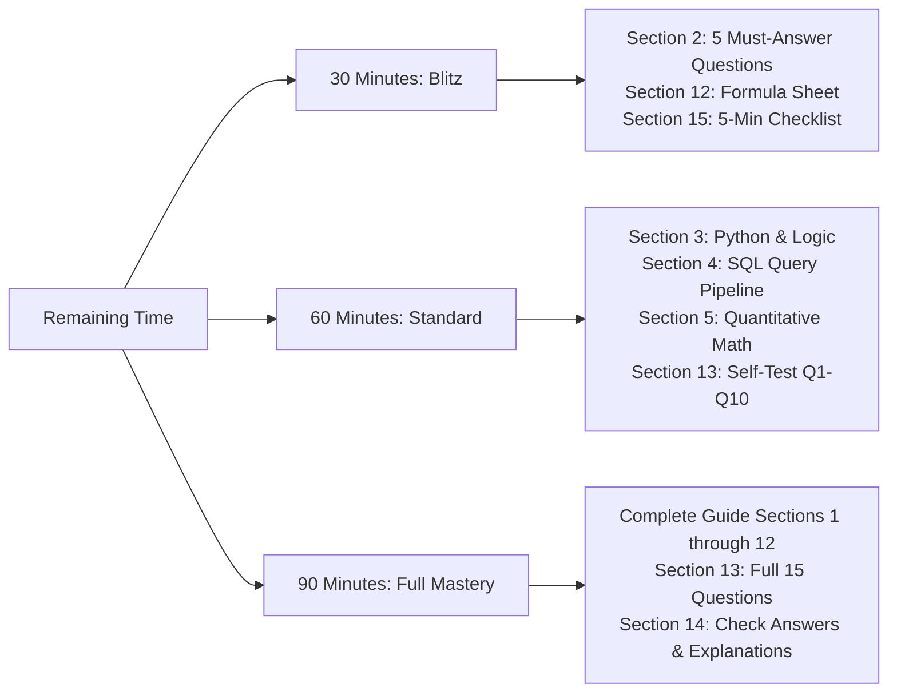

# Rapid Revision — Complete Assessment & Interview Mastery Guide

> **Document Status**: Complete Comprehensive Revision Treatise & Theoretical Explainer  
> **Target Role**: Digital Consultant (Analyst Entry Level), Accenture Japan Ltd. (`[JD VERIFIED]`)  
> **Target Audience**: IIT Kanpur B.Tech / BS / M.Tech / MS Graduates (Class of 2026/2027)  
> **Methodology**: **FABLE** (Findings & Factuality, Assessment & Accuracy, Benchmarks & Boundaries, Explainers & Lessons, Layout & Execution)  
> **Evidence & Scope Disclosure**:  
> * Accenture Japan's official Job Description confirms that Digital Consultants advise Global 2000 and top-tier Japanese enterprises on Cloud, AI/ML, Big Data Analytics, IoT, and Manufacturing Digitalization (`[JD VERIFIED]`).  
> * While Accenture does not mandate a single universal test blueprint across all cohorts, candidate telemetry (e.g., October 2026 reports) identifies formats such as 20 MCQs in 20 minutes followed by 1 coding challenge in 60 minutes, or a 90-minute combined technical and cognitive evaluation.  
> * **Always follow your specific test invitation email** for your assigned format. This document provides deep, high-retention explainers across every high-probability domain.


## 🗺️ Master Table of Contents & Navigation

* [1. How to Use This Revision Guide](#1-how-to-use-this-revision-guide)
  * [⏱️ Route Breakdown](#route-breakdown)
* [2. Five Emergency Questions You Must Answer Immediately](#2-five-emergency-questions-you-must-answer-immediately)
* [3. Section A: Programming Logic, Python Internals & Algorithmic Mechanics (Priority 1)](#3-section-a-programming-logic-python-internals-algorithmic-mechanics-priority-1)
  * [Explainer A.1: Python Execution Model, PyObject, Memory Allocation & Garbage Collection](#explainer-a1-python-execution-model-pyobject-memory-allocation-garbage-collection)
  * [Explainer A.2: Dynamic Array Resizing, Slicing Mechanics & Shallow vs Deep Copy](#explainer-a2-dynamic-array-resizing-slicing-mechanics-shallow-vs-deep-copy)
  * [Explainer A.3: Hash Table Internals, Collision Resolution & Two Sum Invariants](#explainer-a3-hash-table-internals-collision-resolution-two-sum-invariants)
  * [Explainer A.4: Algorithmic Invariants — Two Pointers & Sliding Window Proofs](#explainer-a4-algorithmic-invariants-two-pointers-sliding-window-proofs)
  * [Explainer A.5: Monotonic Structures, Recursion Stack Frames & Trace Tables](#explainer-a5-monotonic-structures-recursion-stack-frames-trace-tables)
  * [Explainer A.6: Common Pseudocode Traps, Operator Precedence & Bitwise Math](#explainer-a6-common-pseudocode-traps-operator-precedence-bitwise-math)
* [4. Section B: Relational Engines, SQL Internals & Query Execution (Priority 1)](#4-section-b-relational-engines-sql-internals-query-execution-priority-1)
  * [Explainer B.1: The 11-Step Logical Query Processing Pipeline](#explainer-b1-the-11-step-logical-query-processing-pipeline)
  * [Explainer B.2: B+ Tree Index Architecture, Clustered vs Secondary Indexes & SARGability](#explainer-b2-b-tree-index-architecture-clustered-vs-secondary-indexes-sargability)
  * [Explainer B.3: Query Optimizer Join Algorithms — Nested Loops vs Hash Join vs Merge Join](#explainer-b3-query-optimizer-join-algorithms-nested-loops-vs-hash-join-vs-merge-join)
  * [Explainer B.4: Aggregation Mechanics, GROUP BY Pipeline & WHERE vs HAVING](#explainer-b4-aggregation-mechanics-group-by-pipeline-where-vs-having)
  * [Explainer B.5: Window Functions Deep-Dive — Partitioning, Ordering & ROWS vs RANGE Frames](#explainer-b5-window-functions-deep-dive-partitioning-ordering-rows-vs-range-frames)
  * [Explainer B.6: Common Table Expressions (CTEs), Recursive Queries & Join Fanout Traps](#explainer-b6-common-table-expressions-ctes-recursive-queries-join-fanout-traps)
  * [Explainer B.7: Three-Valued Logic (3VL), NULL Semantics & Safe Arithmetic](#explainer-b7-three-valued-logic-3vl-null-semantics-safe-arithmetic)
* [5. Section C: Quantitative Aptitude, Commercial Economics & Financial Math (Priority 1)](#5-section-c-quantitative-aptitude-commercial-economics-financial-math-priority-1)
  * [Explainer C.1: Compounded Growth, CAGR Derivation & Volatility Drag Mechanics](#explainer-c1-compounded-growth-cagr-derivation-volatility-drag-mechanics)
  * [Explainer C.2: The Mathematical Foundation of the Rule of 72 & Mental Approximations](#explainer-c2-the-mathematical-foundation-of-the-rule-of-72-mental-approximations)
  * [Explainer C.3: Commercial Economics — Margin vs Markup, Unit Economics & Break-Even Volume](#explainer-c3-commercial-economics-margin-vs-markup-unit-economics-break-even-volume)
  * [Explainer C.4: Enterprise SaaS & Digital Economics — Cohorts, LTV, CAC & Churn Dynamics](#explainer-c4-enterprise-saas-digital-economics-cohorts-ltv-cac-churn-dynamics)
  * [Explainer C.5: Smart Factory Operations — Overall Equipment Effectiveness (OEE) Decomposition](#explainer-c5-smart-factory-operations-overall-equipment-effectiveness-oee-decomposition)
  * [Explainer C.6: Harmonic Mean vs Arithmetic Mean & Alligation Mixture Principles](#explainer-c6-harmonic-mean-vs-arithmetic-mean-alligation-mixture-principles)
* [6. Section D: Computer Science, Operating Systems & Networking Foundations (Priority 2)](#6-section-d-computer-science-operating-systems-networking-foundations-priority-2)
  * [Explainer D.1: Process vs Thread Internals, Memory Segments & Context Switching Overhead](#explainer-d1-process-vs-thread-internals-memory-segments-context-switching-overhead)
  * [Explainer D.2: Concurrency Primitives, Race Conditions, Mutex vs Semaphore & Deadlock Proofs](#explainer-d2-concurrency-primitives-race-conditions-mutex-vs-semaphore-deadlock-proofs)
  * [Explainer D.3: Memory Hierarchy, Virtual Memory, TLB Operation & Page Replacement Algorithms](#explainer-d3-memory-hierarchy-virtual-memory-tlb-operation-page-replacement-algorithms)
  * [Explainer D.4: Networking Protocols — TCP 3-Way Handshake, Flow/Congestion Control vs UDP](#explainer-d4-networking-protocols-tcp-3-way-handshake-flowcongestion-control-vs-udp)
  * [Explainer D.5: Modern Web Architecture — REST Principles, Idempotency & HTTP Status Codes](#explainer-d5-modern-web-architecture-rest-principles-idempotency-http-status-codes)
* [7. Section E: Cloud Computing, Modern Distributed Systems & Reliability (Priority 2)](#7-section-e-cloud-computing-modern-distributed-systems-reliability-priority-2)
  * [Explainer E.1: Cloud Shared Responsibility Matrix (IaaS vs PaaS vs SaaS) & Multi-Tenancy](#explainer-e1-cloud-shared-responsibility-matrix-iaas-vs-paas-vs-saas-multi-tenancy)
  * [Explainer E.2: Distributed Systems Foundations — CAP Theorem, PACELC & Consensus Mechanics](#explainer-e2-distributed-systems-foundations-cap-theorem-pacelc-consensus-mechanics)
  * [Explainer E.3: High Availability Design, Uptime Nines Sizing & Disaster Recovery (RPO vs RTO)](#explainer-e3-high-availability-design-uptime-nines-sizing-disaster-recovery-rpo-vs-rto)
* [8. Section F: Cybersecurity & Enterprise Governance (Priority 2)](#8-section-f-cybersecurity-enterprise-governance-priority-2)
  * [Explainer F.1: Cryptography Foundations — Symmetric (AES) vs Asymmetric (RSA/ECC) & TLS 1.3](#explainer-f1-cryptography-foundations-symmetric-aes-vs-asymmetric-rsaecc-tls-13)
  * [Explainer F.2: Identity & Access Management (IAM) — OAuth 2.0 PKCE Flow, OIDC & JWT Architecture](#explainer-f2-identity-access-management-iam-oauth-20-pkce-flow-oidc-jwt-architecture)
  * [Explainer F.3: OWASP Top Vulnerabilities — SQL Injection, XSS, CSRF & Zero-Trust Architecture](#explainer-f3-owasp-top-vulnerabilities-sql-injection-xss-csrf-zero-trust-architecture)
* [9. Section G: AI, Machine Learning & Generative AI Systems (Priority 2)](#9-section-g-ai-machine-learning-generative-ai-systems-priority-2)
  * [Explainer G.1: Statistical Learning Theory — Bias-Variance Tradeoff, Loss Functions & Regularization](#explainer-g1-statistical-learning-theory-bias-variance-tradeoff-loss-functions-regularization)
  * [Explainer G.2: Evaluation Metrics for Imbalanced Enterprise Data — Precision, Recall, F1 & ROC-AUC](#explainer-g2-evaluation-metrics-for-imbalanced-enterprise-data-precision-recall-f1-roc-auc)
  * [Explainer G.3: Transformer Architecture Mechanics — Scaled Dot-Product Attention & Positional Encoding](#explainer-g3-transformer-architecture-mechanics-scaled-dot-product-attention-positional-encoding)
  * [Explainer G.4: Enterprise Generative AI — RAG Architecture vs Fine-Tuning (LoRA) & Vector Databases](#explainer-g4-enterprise-generative-ai-rag-architecture-vs-fine-tuning-lora-vector-databases)
* [10. Section H: Digital Consulting, Industry 4.0 & Case Frameworks (Priority 2)](#10-section-h-digital-consulting-industry-40-case-frameworks-priority-2)
  * [Explainer H.1: The ISA-95 Smart Manufacturing Hierarchy & Edge-to-Cloud OT/IT Integration](#explainer-h1-the-isa-95-smart-manufacturing-hierarchy-edge-to-cloud-otit-integration)
  * [Explainer H.2: Structured Consulting Problem Solving — MECE Principle, Issue Trees & Hypothesis Testing](#explainer-h2-structured-consulting-problem-solving-mece-principle-issue-trees-hypothesis-testing)
  * [Explainer H.3: DX Financial Modeling — Total Cost of Ownership (TCO), Payback Period & Cloud ROI](#explainer-h3-dx-financial-modeling-total-cost-of-ownership-tco-payback-period-cloud-roi)
* [11. Section I: Japan Business Culture & Accenture Japan Context (Priority 2)](#11-section-i-japan-business-culture-accenture-japan-context-priority-2)
  * [Explainer I.1: Society 5.0, Connected Industries & Japan's 2025 Digital Cliff (2025年の崖)](#explainer-i1-society-50-connected-industries-japans-2025-digital-cliff-2025年の崖)
  * [Explainer I.2: Japanese Corporate Governance — Kaizen, Monozukuri, Ringi-sho & Nemawashi](#explainer-i2-japanese-corporate-governance-kaizen-monozukuri-ringi-sho-nemawashi)
* [12. Section J: High-Density Formula & Command Reference Sheet](#12-section-j-high-density-formula-command-reference-sheet)
* [13. Section K: 15-Question Comprehensive Self-Test Assessment](#13-section-k-15-question-comprehensive-self-test-assessment)
* [14. Section L: Complete Step-by-Step Answer Key with Explanations](#14-section-l-complete-step-by-step-answer-key-with-explanations)
* [15. Section M: Final 5-Minute Pre-Test Mental Checklist](#15-section-m-final-5-minute-pre-test-mental-checklist)

---

## 1. How to Use This Revision Guide

Select your route based on the time remaining before your test:



### ⏱️ Route Breakdown
* **Route 1: 30-Minute Emergency Blitz**
  1. Read **Section 2: Five Emergency Questions You Must Answer Immediately** (5 min).
  2. Review **Section 12: High-Density Formula & Command Reference Sheet** (15 min).
  3. Scan **Section 15: Final 5-Minute Pre-Test Mental Checklist** (5 min).
  4. Skim **Section 13: Questions 1 to 5** to calibrate your problem-solving speed (5 min).

* **Route 2: 60-Minute Standard Route (High Probability Focus)**
  1. Work through **Section 3 (Programming Logic & Python)** and **Section 4 (SQL Engines)** (25 min).
  2. Study **Section 5 (Quantitative & Commercial Math)** (15 min).
  3. Read **Section 6 (OS/Networking)** and **Section 7 (Cloud Infrastructure)** (10 min).
  4. Solve **Section 13 (Questions 1 to 10)** and verify against **Section 14** (10 min).

* **Route 3: 90-Minute Full Mastery Route**
  1. Complete Route 2 systematically (60 min).
  2. Dive into **Section 9 (AI/ML & GenAI)** and **Section 10 (Digital Transformation & ISA-95)** (15 min).
  3. Solve **Section 13 (Questions 11 to 15)** and review enterprise DX frameworks (15 min).


## 2. Five Emergency Questions You Must Answer Immediately

Before entering the assessment portal, verify that you can answer these five foundational interview and test questions with zero hesitation:

### Q1: What is the fundamental difference between `WHERE` and `HAVING` in SQL?
> **Answer**: `WHERE` acts as an individual **row-level filter** evaluated *before* grouping occurs. It cannot evaluate aggregate functions (`SUM`, `AVG`, `COUNT`). `HAVING` acts as a **group-level filter** evaluated *after* `GROUP BY` aggregation, operating directly on aggregate metrics.  
> **Diagnostic Example**: `WHERE status = 'ACTIVE'` removes inactive rows before calculating department payroll; `HAVING SUM(salary) > 1000000` filters out departments whose aggregated payroll is under ¥1M.

### Q2: Why does Python exhibit unexpected behavior with mutable default arguments like `def append_to(item, target=[])`?
> **Answer**: In Python, default parameter expressions are evaluated **once at function definition/compile time**, not dynamically on each function invocation. The list object `[]` is created once and stored in the function's `__defaults__` tuple. Subsequent calls that omit the argument modify the exact same list instance in heap memory.  
> **Diagnostic Fix**: Always use `def append_to(item, target=None):` and inside the function initialize `if target is None: target = []`.

### Q3: What is the difference between an Operating System Process and a Thread?
> **Answer**: A **process** is an independent executing program instance with its own private virtual memory space (text, data, heap, stack), file descriptors, and security tokens; inter-process communication (IPC) requires OS mediators (pipes, sockets, shared memory). A **thread** is the smallest unit of execution *within* a process; all threads belonging to the same process share the process's code segment, heap, and open files, but possess their own private call stack and program counter. Thread creation and context switching incur significantly lower overhead than processes.

### Q4: In Cloud Infrastructure, what are the architectural boundaries of IaaS, PaaS, and SaaS?
> **Answer**: Under the Cloud Shared Responsibility Model:
> * **IaaS (Infrastructure as a Service)**: Provider manages physical facilities, hypervisors, and hardware networking. The enterprise manages OS patches, middleware, runtimes, database software, application code, and data (e.g., AWS EC2, Azure VMs).
> * **PaaS (Platform as a Service)**: Provider manages hardware, OS, middleware, and runtime engines. The enterprise manages only application logic, configurations, and data (e.g., AWS Elastic Beanstalk, Azure App Service, Google App Engine).
> * **SaaS (Software as a Service)**: Provider manages the entire vertical stack from hardware to software updates. The enterprise only manages user identities, data access permissions, and application configuration (e.g., Salesforce, Microsoft 365, Workday).

### Q5: If a digital conversion rate increases from 4.0% to 5.0%, what is the percentage-point increase versus relative percentage increase?
> **Answer**: 
> * **Percentage-Point Increase**: Direct arithmetic difference: $5.0\% - 4.0\% = \mathbf{+1.0\text{ percentage point (pp)}}$.
> * **Relative Percentage Increase**: Proportional change relative to baseline: $\frac{5.0 - 4.0}{4.0} \times 100\% = \frac{1.0}{4.0} \times 100\% = \mathbf{+25.0\%}$.  
> * **Consulting Tip**: Stating a "1% increase" when reporting a move from 4% to 5% is ambiguous and mathematically imprecise; always clarify whether it is $+1.0\text{ pp}$ or a $+25\%$ relative uplift.


## 3. Section A: Programming Logic, Python Internals & Algorithmic Mechanics (Priority 1)

### Explainer A.1: Python Execution Model, PyObject, Memory Allocation & Garbage Collection

#### 1. Mental Model: The CPython Runtime & "Everything is an Object"
In native compiled languages like C/C++, variables correspond to fixed memory addresses on the stack or heap holding primitive binary data (e.g., an 8-byte IEEE 754 float). In CPython, **every variable is a pointer to a heap-allocated `PyObject` structure**.

```text
CPython PyObject Architecture (64-bit architecture):
+-----------------------------------------------------------+
| ob_refcnt  (8 bytes) -> 64-bit reference counter          |
| ob_type    (8 bytes) -> Pointer to type object structure  |
| [Type-specific payload, e.g., ob_size, ob_digit array]    |
+-----------------------------------------------------------+
```
Even a simple integer `x = 42` is not a raw 4-byte scalar; it is a full 28-byte `PyLongObject` allocated on the heap containing reference tracking metadata and arbitrary-precision integer digit buffers.

#### 2. Memory Allocation & Small Object Allocator (PyMalloc)
To prevent constant calls to the OS kernel `malloc()` (which introduces severe fragmentation for tiny objects), CPython incorporates **PyMalloc**:
* **Arenas**: 256 KB memory chunks allocated from the OS.
* **Pools**: 4 KB subdivisions within arenas, dedicated to specific size classes (8 bytes, 16 bytes, up to 512 bytes).
* **Blocks**: Fixed-size memory chunks inside pools. When an integer or small string is created, CPython assigns an available block in $O(1)$ time without kernel context switches.
```python
a = 100
b = 100
assert a is b  # True: Both names point to the singleton cached PyLongObject!

c = 1000
d = 1000
# c is d may evaluate to False because integers outside [-5, 256] allocate distinct objects.
```

#### 3. Garbage Collection Mechanics (Reference Counting + Generational Cycler)
CPython employs a two-tier memory reclamation engine:
1. **Reference Counting (Primary Engine)**:
   - Every `PyObject` tracks how many references point to it (`ob_refcnt`).
   - When a reference goes out of scope, is reassigned, or deleted (`del`), `ob_refcnt` decrements by 1.
   - The instant `ob_refcnt == 0`, memory is immediately deallocated back to PyMalloc.
   - *Limitation*: Reference counting cannot reclaim **cyclic references** (e.g., node $A$ points to node $B$, and node $B$ points back to node $A$; deleting external pointers leaves both with `refcnt == 1`, causing an permanent memory leak).
2. **Generational Cyclic Garbage Collector (Secondary Engine)**:
   - Scans container objects (`list`, `dict`, `set`, custom classes, tuples containing mutable elements).
   - Groups objects into three generations: **Generation 0** (newly allocated), **Generation 1** (survived 1 collection), and **Generation 2** (long-lived objects).
   - *Collection Frequency*: Gen 0 is inspected frequently (e.g., after 700 net allocations). Objects surviving inspection are promoted to Gen 1. If Gen 1 collections exceed 10 cycles, Gen 2 is collected.
   - *Algorithm*: Uses pointer subtraction to identify isolated unreachable cyclic reference graphs and frees them.

#### 4. The Global Interpreter Lock (GIL) Explainer
* CPython's memory allocator is not thread-safe. To prevent race conditions on `ob_refcnt` updates, CPython uses the **GIL (Global Interpreter Lock)** — a mutual exclusion lock that permits only **one native thread to execute Python bytecode at any given moment**, regardless of how many CPU cores are physically available.
* **CPU-Bound Code**: Spawning 8 Python `threading.Thread` instances on an 8-core CPU does *not* speed up calculation; lock contention and thread switching actually make it run slower! For CPU-bound acceleration, you must use `multiprocessing` (separate OS processes with independent memory spaces and separate GILs) or offload computation to vectorized C/C++ libraries (NumPy, Polars).
* **I/O-Bound Code**: Python threads release the GIL during network I/O, disk operations, and database calls (`time.sleep()`, socket reads). Thus, multi-threading is highly effective for concurrent API scraping, database queries, and web servers.

---

### Explainer A.2: Dynamic Array Resizing, Slicing Mechanics & Shallow vs Deep Copy

#### 1. Under-the-Hood: How Python `list` Over-Allocates
A Python `list` is not a linked list; it is a **contiguous array of pointers to `PyObject` instances** (`PyObject** ob_item`).
When you call `list.append()`, CPython cannot afford to call `realloc()` on every single element because memory reallocation is an $O(N)$ memory copying operation. Instead, it uses **geometric amortized over-allocation**:

$$\text{new\_allocated} = \text{newsize} + (\text{newsize} \gg 3) + (\text{newsize} < 9 \ ? \ 3 : 6)$$

* **Growth Sequence**: 0, 4, 8, 16, 24, 32, 40, 52, 64, 76, ...
* **Amortized Complexity**: Appending $N$ elements takes $O(N)$ total time, yielding **$O(1)$ amortized cost per append**.
* **The `insert(0, x)` Disaster**: Inserting at index 0 requires shifting every existing pointer in memory rightward by one slot — a strictly **$O(N)$ operation**. If an assessment problem requires a double-ended queue, always use `collections.deque` (implemented as a doubly-linked list of 64-element block arrays), providing strictly $O(1)$ `appendleft()` and `popleft()`.

#### 2. Slicing Mechanics & Off-by-One Protection
Slicing `arr[start:stop:step]` constructs a brand new `list` containing shallow copies of the pointer references in the range $[start, stop)$.
* `start`: Inclusive boundary (defaults to 0 if omitted).
* `stop`: Exclusive boundary (defaults to `len(arr)` if omitted).
* `step`: Index delta (negative values step backwards).
* **Slice Length Identity**: When `step = 1`, the number of elements extracted is strictly $\max(0, stop - start)$.

```python
data = [10, 20, 30, 40, 50, 60]
# Indices:  0   1   2   3   4   5
# Negatives:-6  -5  -4  -3  -2  -1

assert data[2:5] == [30, 40, 50]       # Length = 5 - 2 = 3 elements
assert data[-3:] == [40, 50, 60]       # Last 3 elements
assert data[:3]  == [10, 20, 30]       # First 3 elements
assert data[::2] == [10, 30, 50]       # Even indices
assert data[::-1] == [60, 50, 40, 30, 20, 10]  # O(N) reverse
```

#### 3. Shallow Copy vs Deep Copy
* **Shallow Copy (`list.copy()`, `arr[:]`, `dict.copy()`)**: Allocates a new outer container, but **copies the object references** of its contents. If the elements are themselves mutable (e.g., nested lists, dictionaries), modifying an inner element through the clone mutates the original!
* **Deep Copy (`copy.deepcopy()`)**: Recursively traverses the object graph, allocating brand new memory for every nested mutable container and mapping traversed object IDs to avoid infinite loops on cyclic graphs.

```python
import copy

original = [[1, 2], [3, 4]]
shallow = original.copy()
deep = copy.deepcopy(original)

shallow[0][0] = 999
assert original[0][0] == 999  # Mutated original! Because pointer was shared!

deep[1][1] = 888
assert original[1][1] == 4    # Untouched! Deep copy allocated distinct memory!
```

---

### Explainer A.3: Hash Table Internals, Collision Resolution & Two Sum Invariants

#### 1. CPython Compact Hash Table Architecture
Since Python 3.6+, dictionaries are ordered by insertion. CPython achieves this using a **two-table compact array design**:
1. **Sparse Hash Index Table (`indices`)**: An array of small integers (e.g., int8, int16) indexed by `hash(key) % table_size`.
2. **Dense Entries Table (`entries`)**: An array of contiguous structs storing `[hash_code, key_pointer, value_pointer]`.

```text
Visualizing CPython Dict ("compact table"):
indices: [ -1,  0, -1,  1, -1, -1, -1, -1 ]  <- hash(key) % 8 points here
entries:
  0: hash=39481, key="tokyo", value="HQ"
  1: hash=12093, key="kyoto", value="Branch"
```
* **Memory Savings**: Replaces 24-byte sparse bucket tables with 1-byte indices arrays, cutting dictionary memory consumption by $30\%\text{--}40\%$.
* **Collision Resolution**: Uses open addressing with **pseudo-random perturbation probing**:
  $$j = (5j + 1 + \text{perturb}) \pmod{2^i}$$
  where `perturb` is initialized to the full hash code and shifted right by 5 bits on each probe iteration (`perturb >>= 5`). This decorrelates linear clustering and rapidly scans the table.

#### 2. The Two-Sum Mathematical Invariant
* **Problem**: Given array $A$ and target integer $K$, find indices $(i, j)$ such that $A[i] + A[j] = K$ with $i \ne j$.
* **Brute Force**: Two nested loops testing all $\frac{N(N-1)}{2}$ pairs $\implies O(N^2)$ time, $O(1)$ space.
* **Hash Invariant Transformation**: Rearrange the equation:
  $$A[i] + A[j] = K \iff A[i] = K - A[j]$$
* **Algorithm**: Iterate through array with pointer $j$. The required complement is $C_j = K - A[j]$. If $C_j$ exists in our hash table, we have discovered the exact matching pair in $O(1)$ lookup time. If not, record $A[j]$ and its index $j$ into the hash table.
* **Time Complexity**: Exactly 1 pass over array $\implies \mathbf{O(N)}$ time, $\mathbf{O(N)}$ auxiliary space.

```python
def two_sum(nums: list[int], target: int) -> list[int]:
    lookup = {}  # complement -> index
    for current_idx, num in enumerate(nums):
        complement = target - num
        if complement in lookup:
            return [lookup[complement], current_idx]
        lookup[num] = current_idx
    return []

assert two_sum([2, 7, 11, 15], 9) == [0, 1]
assert two_sum([3, 2, 4], 6) == [1, 2]
assert two_sum([3, 3], 6) == [0, 1]
```

---

### Explainer A.4: Algorithmic Invariants — Two Pointers & Sliding Window Proofs

#### 1. Two Pointers Invariant Proof (Sorted Array Target Sum)
* **Precondition**: Array $A$ is sorted monotonically ($A[0] \le A[1] \le \dots \le A[N-1]$).
* **Pointers**: `left = 0`, `right = N - 1`.
* **Invariant**: At any step, the search space for valid solutions is strictly confined to the subsegment $A[\text{left} \dots \text{right}]$.
* **Deduction Steps**:
  1. Compute $S = A[\text{left}] + A[\text{right}]$.
  2. If $S == \text{Target}$, return indices.
  3. If $S < \text{Target}$: Since $A[\text{right}]$ is the largest available element in the search window, pairing $A[\text{left}]$ with any other element in $A[\text{left} \dots \text{right}]$ would produce an even smaller sum $< S < \text{Target}$. Thus, $A[\text{left}]$ cannot be part of any valid pair. We safely discard it by incrementing `left += 1`.
  4. If $S > \text{Target}$: By symmetric logic, $A[\text{right}]$ paired with any element in $A[\text{left} \dots \text{right}]$ produces a sum $\ge A[\text{left}] + A[\text{right}] > \text{Target}$. We safely discard $A[\text{right}]$ by decrementing `right -= 1`.
* **Complexity**: Each comparison eliminates at least one element. Maximum comparisons $= N \implies \mathbf{O(N)}$ time, $\mathbf{O(1)}$ space.

#### 2. Sliding Window Dynamic Constraint Maintenance
Sliding windows solve contiguous subarray optimization problems.
* **Invariant**: Maintain a window $[L, R]$ such that a state predicate $P(L, R)$ remains satisfied.
* **State Expansion**: Increment $R$, assimilating $A[R]$ into the running window telemetry.
* **State Contraction**: If incorporating $A[R]$ causes $P(L, R)$ to become `FALSE`, increment $L$ iteratively, removing $A[L]$ from running metrics until $P(L, R)$ is restored to `TRUE`.

```python
def max_ones_after_one_flip(s: str) -> int:
    # Longest contiguous subarray of 1s with at most one 0 flipped.
    # Predicate P(L, R): count('0' in s[L:R+1]) <= 1.
    left = 0
    zero_count = 0
    best_len = 0
    
    for right in range(len(s)):
        if s[right] == '0':
            zero_count += 1
            
        # Contract while invariant is violated
        while zero_count > 1:
            if s[left] == '0':
                zero_count -= 1
            left += 1
            
        # Here P(L, R) is guaranteed TRUE
        best_len = max(best_len, right - left + 1)
        
    return best_len

assert max_ones_after_one_flip("110110111") == 6  # Flipping second zero yields "110111111" -> 6 ones
assert max_ones_after_one_flip("000") == 1
assert max_ones_after_one_flip("1111") == 4
```

---

### Explainer A.5: Monotonic Structures, Recursion Stack Frames & Trace Tables

#### 1. Monotonic Stack Mechanics (Next Greater Element)
A **Monotonic Stack** enforces strict element ordering (either monotonically increasing or decreasing).
* **Use Case**: Finding the **Next Greater Element (NGE)** or Nearest Smaller Element for every position in an array in $O(N)$ linear time, avoiding $O(N^2)$ brute-force scans.
* **Invariant**: Elements in the stack are strictly decreasing from bottom to top.
* **Execution**:
  When element $A[i]$ arrives, while stack is non-empty and $A[i] > A[\text{stack.top()}]$, $A[i]$ is the Next Greater Element for $\text{stack.top()}$. We pop the stack and record $A[i]$. Then we push index $i$.

```python
def next_greater_elements(nums: list[int]) -> list[int]:
    result = [-1] * len(nums)
    stack = []  # stores indices
    
    for i, val in enumerate(nums):
        while stack and nums[stack[-1]] < val:
            popped_idx = stack.pop()
            result[popped_idx] = val
        stack.append(i)
        
    return result

assert next_greater_elements([2, 1, 2, 4, 3]) == [4, 2, 4, -1, -1]
```

#### 2. Trace Table: Tracking Recursion & Stack State
Consider recursive binary search on sorted array `[2, 5, 8, 12, 16, 23, 38, 56, 72, 91]`, searching for `Target = 23`:

| Call # | `low` | `high` | `mid` | `arr[mid]` | Condition Check | Action / Next Frame |
|:---:|:---:|:---:|:---:|:---:|:---:|:---:|
| **1** | 0 | 9 | $0 + (9-0)//2 = 4$ | 16 | $16 < 23$ | `low = mid + 1 = 5` |
| **2** | 5 | 9 | $5 + (9-5)//2 = 7$ | 56 | $56 > 23$ | `high = mid - 1 = 6` |
| **3** | 5 | 6 | $5 + (6-5)//2 = 5$ | 23 | $23 == 23$ | **Target Found at index 5!** |

* **Total Iterations**: $\lceil\log_2(10)\rceil = 3\text{ comparisons}$. Brute force would require 6 comparisons.

---

### Explainer A.6: Common Pseudocode Traps, Operator Precedence & Bitwise Math

#### 1. Operator Precedence Hierarchy (Highest to Lowest)
1. Parentheses: `()`
2. Exponentiation: `**` (Evaluates **right-to-left**: `2 ** 3 ** 2 == 2 ** 9 == 512`, NOT `8 ** 2 == 64`)
3. Unary Operators: `+x`, `-x`, `~x`
4. Multiplication, Division, Floor Div, Modulo: `*`, `/`, `//`, `%`
5. Addition, Subtraction: `+`, `-`
6. Bitwise Shifts: `<<`, `>>`
7. Bitwise AND: `&`
8. Bitwise XOR: `^`
9. Bitwise OR: `|`
10. Comparison Operators: `<`, `<=`, `>`, `>=`, `==`, `!=`, `is`, `in`
11. Boolean NOT: `not`
12. Boolean AND: `and`
13. Boolean OR: `or`

#### 2. Bitwise Logic & Fast Power-of-Two Invariant
* **Check if $N$ is a power of 2**:
  A positive integer $N$ is a power of 2 if and only if its binary representation contains exactly one `1` bit (e.g., $16 = 10000_2$).
  Subtracting 1 flips all bits up to the lowest set bit: $15 = 01111_2$.
  Therefore, bitwise AND produces identically zero:
  $$N > 0 \quad \text{and} \quad (N \ \& \ (N - 1)) == 0$$
* **Fast Multiplications and Divisions**:
  - $N \ll k \iff N \times 2^k$ (Bitwise Left Shift).
  - $N \gg k \iff \lfloor N / 2^k \rfloor$ (Bitwise Right Shift).


## 4. Section B: Relational Engines, SQL Internals & Query Execution (Priority 1)

### Explainer B.1: The 11-Step Logical Query Processing Pipeline

SQL is a **declarative language** where the developer specifies *what* data to retrieve, not the procedural execution steps. The RDBMS query optimizer translates this declarative statement into an imperative execution plan following a strict mathematical sequence:

```text
Logical Query Execution Pipeline:
(1)  FROM        -> Identifies, loads, and Cartesian-crosses base physical tables
(2)  ON          -> Applies join predicates to filter the Cartesian product
(3)  JOIN        -> Emits matched rows (or injects outer NULLs for LEFT/RIGHT/FULL JOIN)
(4)  WHERE       -> Evaluates row-level predicates before any aggregation occurs
(5)  GROUP BY    -> Organizes surviving rows into distinct partition groups
(6)  HAVING      -> Evaluates aggregate predicates across grouped partitions
(7)  WINDOW      -> Computes analytical functions (OVER PARTITION BY ... ORDER BY ...)
(8)  SELECT      -> Evaluates projection expressions, scalar functions, and assigns aliases
(9)  DISTINCT    -> Eliminates duplicate projected output rows
(10) ORDER BY    -> Sorts final result rows according to specified collations
(11) LIMIT/OFFSET-> Applies pagination bounds and truncates the streaming cursor
```

#### Why This Explains Common Assessment Errors:
* **The `WHERE` Alias Prohibition**: Because Step 4 (`WHERE`) executes long before Step 8 (`SELECT`), writing `WHERE total_revenue > 1000` causes an immediate `Column does not exist` error if `total_revenue` is an alias created in the `SELECT` clause.
* **The `ORDER BY` Alias Permission**: Because Step 10 (`ORDER BY`) executes after Step 8 (`SELECT`), referencing aliases created in `SELECT` is completely valid and encouraged.
* **`WHERE` vs `HAVING` Performance Traps**: Placing a non-aggregate filter into `HAVING` (e.g., `HAVING region = 'Kanto'`) forces the database engine to group *all* rows across the entire company before discarding non-Kanto groups. Moving that predicate into `WHERE region = 'Kanto'` discards non-Kanto rows in Step 4, reducing grouping memory and CPU cycles by $80\%\text{--}90\%$.

---

### Explainer B.2: B+ Tree Index Architecture, Clustered vs Secondary Indexes & SARGability

#### 1. Why RDBMSs Use B+ Trees Instead of Binary Search Trees or Hash Tables
* **High Fanout & Low Tree Depth**: A B+ Tree node matches the operating system disk page size (typically 4 KB or 8 KB). A single node can hold hundreds of keys ($B \approx 100\text{--}500$), keeping tree height to just 3 or 4 levels for hundreds of millions of rows.
* **Sequential Range Scans**: Unlike standard B-Trees, **B+ Trees store data records exclusively in the leaf nodes**. All leaf nodes are linked as a doubly-linked list. To execute `WHERE date BETWEEN '2026-01-01' AND '2026-03-31'`, the engine performs 1 tree traversal ($O(\log N)$) to find the start date, then simply walks the linked leaf list sequentially ($O(K)$) without re-traversing upper tree levels.

#### 2. Clustered Index vs Secondary Non-Clustered Index
* **Clustered Index**: Defines the **physical ordering** of rows on disk. A table can possess **at most one clustered index** (typically the Primary Key). Leaf nodes contain the actual complete table row data pages.
* **Secondary (Non-Clustered) Index**: A separate B+ Tree structure whose leaf nodes contain the indexed column keys plus a pointer back to the base data row:
  - In PostgreSQL: A tuple physical address (`TID` = block number + item offset).
  - In MySQL InnoDB / SQL Server: The clustered index Primary Key value.
* **Index Lookup vs Index Scan vs Index Seek**:
  - **Index Seek**: Engine uses B+ Tree root-to-leaf traversal to pinpoint exact keys ($O(\log N)$). Fastest access path.
  - **Covering Index**: A secondary index that contains all columns requested by the `SELECT` query (either in key or `INCLUDE` clause). Avoids expensive secondary "Bookmark / Key Lookups" back to the clustered table!

#### 3. SARGability (Search Argument Able) Traps
A query is **SARGable** if the optimizer can leverage an index seek rather than resorting to a full index/table scan:
* **Non-SARGable (Index Invalidation)**:
  - Wrapping indexed columns in functions: `WHERE YEAR(order_date) = 2026` (Forces engine to compute `YEAR()` on every single row).
  - *SARGable Fix*: `WHERE order_date >= '2026-01-01' AND order_date < '2027-01-01'`.
  - Leading-edge wildcards: `WHERE customer_name LIKE '%Tanaka'` (B+ Tree cannot use alphabetical prefix ordering; forces full scan).
  - Implicit type conversions: `WHERE phone_number = 9012345678` (where `phone_number` is `VARCHAR`).

---

### Explainer B.3: Query Optimizer Join Algorithms — Nested Loops vs Hash Join vs Merge Join

The Cost-Based Optimizer (CBO) evaluates table statistics histograms and picks among three fundamental join physical operators:

| Join Algorithm | Mechanism & Memory Behavior | Best Fit Scenario | Worst Fit Scenario |
|:---|:---|:---|:---|
| **Nested Loop Join** | Outer loop scans driving table; for each row, inner loop probes index on target table ($O(M \log N)$). | One small table ($M < 100$) joining an indexed large table. | Two massive unindexed tables ($O(M \times N)$ Cartesian explosion). |
| **Hash Join** | Build phase: Hashes smaller table into in-memory hash table. Probe phase: Streams larger table, checking hash keys ($O(M + N)$). | Large unindexed tables where memory is sufficient to store the build table. | Memory-constrained environments where hash spills to disk (*Grace Hash Join*). |
| **Merge Join** | Both tables are sorted by join key, then walked in unison with two pointers ($O(M \log M + N \log N)$). | Massive tables that are already physically sorted by clustered indexes. | Unsorted tables requiring high-cost external sorting. |

---

### Explainer B.4: Aggregation Mechanics, GROUP BY Pipeline & WHERE vs HAVING

* **The Projection Rule**: Every column in `SELECT` must either appear in `GROUP BY` or be wrapped in an aggregate function (`COUNT`, `SUM`, `AVG`, `MIN`, `MAX`).
* **`COUNT(*)` vs `COUNT(col)`**:
  - `COUNT(*)` counts physical row emissions from Step 3/4, including all-null rows.
  - `COUNT(col)` evaluates the column value and ignores rows where `col IS NULL`.
  - `COUNT(DISTINCT col)` builds a hash set of non-null values in memory to count cardinality.

```sql
-- Production Analytical Pattern: Regional Revenue & Basket Sizing
SELECT 
    region,
    store_id,
    COUNT(order_id) AS total_orders,
    SUM(order_amount) AS total_revenue,
    ROUND(AVG(order_amount), 2) AS avg_basket_value
FROM store_transactions
WHERE transaction_status = 'SETTLED'     -- Step 4: Row-level filter
GROUP BY region, store_id               -- Step 5: Partition groups
HAVING SUM(order_amount) >= 10000000    -- Step 6: Group aggregate filter
ORDER BY total_revenue DESC             -- Step 10: Sort by alias
LIMIT 5;                                -- Step 11: Top 5 stores
```

---

### Explainer B.5: Window Functions Deep-Dive — Partitioning, Ordering & ROWS vs RANGE Frames

Window functions compute values across sets of rows related to the current row without collapsing rows into a single output.

#### 1. The Ranking Trinity: `ROW_NUMBER()` vs `RANK()` vs `DENSE_RANK()`
Given employee sales: `[¥10M, ¥10M, ¥8M, ¥6M]`:
* `ROW_NUMBER()`: `1, 2, 3, 4` (Strictly sequential; ties broken arbitrarily).
* `RANK()`: `1, 1, 3, 4` (Ties share rank; skips subsequent ranks).
* `DENSE_RANK()`: `1, 1, 2, 3` (Ties share rank; **no gaps** in ranking sequence).

#### 2. Analytical Offsets: `LEAD()` and `LAG()`
* `LAG(col, offset, default)`: Accesses data from $N$ rows prior to the current row. Essential for calculating Month-over-Month (MoM) revenue growth:
  $$\text{MoM Growth \%} = \frac{\text{Revenue} - \text{LAG}(\text{Revenue}, 1)}{\text{LAG}(\text{Revenue}, 1)} \times 100$$
* `LEAD(col, offset, default)`: Accesses data from $N$ rows ahead of the current row.

#### 3. Framing Mechanics: `ROWS` vs `RANGE`
* `ROWS BETWEEN 2 PRECEDING AND CURRENT ROW`: Exact physical 3-row moving average.
* **The Dangerous Default**: Specifying `ORDER BY` without an explicit frame clause defaults to:
  `RANGE BETWEEN UNBOUNDED PRECEDING AND CURRENT ROW`
  In `RANGE` mode, SQL groups all duplicate values of the ordering key together, causing duplicate cumulative sums and performance degradation! Always specify `ROWS` when calculating physical moving averages.

```sql
-- Production Pattern: 7-Day Moving Average & Day-over-Day Growth
SELECT 
    report_date,
    daily_revenue,
    -- Exact 7-day physical moving average
    ROUND(AVG(daily_revenue) OVER (
        ORDER BY report_date 
        ROWS BETWEEN 6 PRECEDING AND CURRENT ROW
    ), 2) AS mavg_7d_revenue,
    -- Day-over-Day variance
    daily_revenue - LAG(daily_revenue, 1) OVER (ORDER BY report_date) AS dod_change
FROM factory_daily_output;
```

---

### Explainer B.6: Common Table Expressions (CTEs), Recursive Queries & Join Fanout Traps

#### 1. Preventing Join Fanout Revenue Multiplication
When a parent table (`clients`) has a 1-to-many relationship with `orders` (e.g., 3 orders) and another 1-to-many relationship with `complaints` (e.g., 4 complaints), joining both directly produces a **Cartesian fanout of $3 \times 4 = 12$ rows**. Summing revenue across this joined table multiplies client spending by a factor of 4!
* **The Fix**: Pre-aggregate each 1-to-many child table in an isolated CTE before executing the final `LEFT JOIN`:

```sql
WITH client_orders AS (
    SELECT client_id, SUM(order_total) AS total_spent
    FROM sales_orders
    WHERE order_status = 'COMPLETED'
    GROUP BY client_id
),
client_complaints AS (
    SELECT client_id, COUNT(ticket_id) AS total_tickets
    FROM support_tickets
    GROUP BY client_id
)
SELECT 
    c.client_id,
    c.client_name,
    COALESCE(o.total_spent, 0) AS total_spent,
    COALESCE(t.total_tickets, 0) AS total_tickets
FROM enterprise_clients c
LEFT JOIN client_orders o ON c.client_id = o.client_id
LEFT JOIN client_complaints t ON c.client_id = t.client_id;
```

#### 2. Recursive CTEs (Organizational Hierarchies)
A Recursive CTE consists of an **Anchor Member** (initial base query) followed by `UNION ALL` and a **Recursive Member** referencing the CTE itself:

```sql
WITH RECURSIVE org_chart AS (
    -- Anchor Member: Root CEO (reports_to IS NULL)
    SELECT employee_id, name, reports_to, 1 AS depth_level
    FROM employees
    WHERE reports_to IS NULL
    
    UNION ALL
    
    -- Recursive Member: Subordinates reporting to previous level
    SELECT e.employee_id, e.name, e.reports_to, o.depth_level + 1
    FROM employees e
    INNER JOIN org_chart o ON e.reports_to = o.employee_id
)
SELECT * FROM org_chart ORDER BY depth_level, employee_id;
```

---

### Explainer B.7: Three-Valued Logic (3VL), NULL Semantics & Safe Arithmetic

In SQL, `NULL` represents the total absence of a value or an unknown condition.

#### 1. Truth Tables under Three-Valued Logic
* `TRUE AND UNKNOWN` $\rightarrow$ `UNKNOWN`
* `FALSE AND UNKNOWN` $\rightarrow$ `FALSE`
* `TRUE OR UNKNOWN` $\rightarrow$ `TRUE`
* `FALSE OR UNKNOWN` $\rightarrow$ `UNKNOWN`
* `NOT UNKNOWN` $\rightarrow$ `UNKNOWN`

#### 2. The Equality Trap
Never write `WHERE status = NULL`. In SQL, `NULL = NULL` evaluates to `UNKNOWN`. In a `WHERE` filter, rows are returned **only if the predicate evaluates strictly to `TRUE`**; `UNKNOWN` is rejected. Always use `IS NULL` or `IS NOT NULL`.

#### 3. The Catastrophic `NOT IN (Subquery)` Trap
If a subquery returns even a single `NULL`, `WHERE id NOT IN (SELECT supervisor_id FROM ...)` evaluates to:
`id != 1 AND id != 2 AND id != NULL`
Since `id != NULL` evaluates to `UNKNOWN`, the entire `AND` chain becomes `UNKNOWN`. The query returns **0 rows**, silently dropping all valid data!
* *Fix*: Use `NOT EXISTS`:
  ```sql
  WHERE NOT EXISTS (
      SELECT 1 FROM employees s WHERE s.supervisor_id = e.employee_id
  )
  ```

#### 4. Safe Divide-by-Zero Protection
Division by zero crashes database batch jobs. Protect every ratio:
$$\text{Safe Ratio} = \frac{\text{Numerator}}{\text{NULLIF}(\text{Denominator}, 0)}$$
If `Denominator == 0`, `NULLIF` converts it to `NULL`. Since any number divided by `NULL` yields `NULL`, the calculation safely returns `NULL` without aborting the transaction.


## 5. Section C: Quantitative Aptitude, Commercial Economics & Financial Math (Priority 1)

### Explainer C.1: Compounded Growth, CAGR Derivation & Volatility Drag Mechanics

#### 1. First-Principles Derivation of CAGR
Suppose an initial investment $V_{\text{initial}}$ grows under a constant annual geometric growth rate $r$ for $n$ compounding years to reach terminal value $V_{\text{final}}$:

$$V_{\text{final}} = V_{\text{initial}} \cdot (1 + r)^n$$

Dividing both sides by $V_{\text{initial}}$:
$$\frac{V_{\text{final}}}{V_{\text{initial}}} = (1 + r)^n$$

Taking the $n$-th root (raising both sides to power $1/n$):
$$(1 + r) = \left(\frac{V_{\text{final}}}{V_{\text{initial}}}\right)^{\frac{1}{n}}$$

Isolating the Compound Annual Growth Rate $r$ ($\text{CAGR}$):
$$\mathbf{\text{CAGR} = \left(\frac{V_{\text{final}}}{V_{\text{initial}}}\right)^{\frac{1}{n}} - 1}$$

#### 2. The Volatility Drag Mathematical Proof
Why do financial analysts and management consultants strictly avoid using the arithmetic mean for multi-year performance?
Let an asset return $r_1$ in Year 1 and $r_2$ in Year 2.
* **Arithmetic Mean**: $\bar{r} = \frac{r_1 + r_2}{2}$.
* **True Compounded Return**: $R_{\text{compound}} = \sqrt{(1 + r_1)(1 + r_2)} - 1$.
* **Taylor Series Approximation**:
  Expanding the natural logarithm $\ln(1+r) \approx r - \frac{r^2}{2}$:
  $$\ln(1 + R_{\text{compound}}) = \frac{\ln(1 + r_1) + \ln(1 + r_2)}{2} \approx \frac{r_1 + r_2}{2} - \frac{r_1^2 + r_2^2}{4}$$
  Recognizing variance $\sigma^2 = \frac{(r_1 - \bar{r})^2 + (r_2 - \bar{r})^2}{2}$:
  $$\mathbf{R_{\text{compound}} \approx \bar{r} - \frac{\sigma^2}{2}}$$
* **Core Insight**: The compounded return is **strictly less than the arithmetic mean by half the variance** ($\frac{\sigma^2}{2}$). Volatility acts as a mathematical penalty (volatility drag) reducing real wealth.

---

### Explainer C.2: The Mathematical Foundation of the Rule of 72 & Mental Approximations

#### 1. Why 72? Derivation from Natural Logarithms
Let an asset grow at annual rate $r$ (expressed as a decimal). The time $t$ required to double ($V_{\text{final}} = 2 \cdot V_{\text{initial}}$) is:

$$(1 + r)^t = 2 \implies t \cdot \ln(1 + r) = \ln(2)$$

We know $\ln(2) \approx 0.693147$.
Using the Taylor expansion for small $r$: $\ln(1 + r) = r - \frac{r^2}{2} + \frac{r^3}{3} - \dots \approx r$.
Thus:
$$t \approx \frac{0.693147}{r} = \frac{69.3}{r \times 100}$$

#### 2. Why RDBMS and Consultants Adjust 69.3 to 72:
* **Higher Rates**: For realistic business growth rates ($8\%\text{--}15\%$), the second-order term $\frac{r^2}{2}$ becomes significant, shifting the ideal numerator from $69.3$ to approximately $71\text{--}72$.
* **High Divisibility**: 72 is an abundant composite number divisible by $2, 3, 4, 6, 8, 9, 12, 18, 24, 36$, allowing rapid mental calculation in interview rooms without pen and paper!

```text
At 6%  growth -> 72 / 6  = 12.0 years to double  (Exact: 11.90 years)
At 8%  growth -> 72 / 8  = 9.0  years to double  (Exact: 9.01 years)
At 12% growth -> 72 / 12 = 6.0  years to double  (Exact: 6.12 years)
```

---

### Explainer C.3: Commercial Economics — Margin vs Markup, Unit Economics & Break-Even Volume

#### 1. Margin vs Markup Interconversion Proof
* Let Cost of Goods Sold = $C$, Revenue = $R$, Profit = $P = R - C$.
* **Markup ($M$)**: Ratio of Profit to Cost $\implies M = \frac{P}{C} \implies P = M \cdot C \implies R = C + M \cdot C = C(1 + M)$.
* **Margin ($G$)**: Ratio of Profit to Revenue $\implies G = \frac{P}{R}$.
* Substituting $P = M \cdot C$ and $R = C(1 + M)$:
  $$G = \frac{M \cdot C}{C(1 + M)} \implies \mathbf{G = \frac{M}{1 + M}}$$
* Rearranging to express Markup in terms of Margin:
  $$G(1 + M) = M \implies G + G \cdot M = M \implies G = M(1 - G) \implies \mathbf{M = \frac{G}{1 - G}}$$

| Markup on Cost ($M$) | Equivalent Margin on Sales ($G$) | Concrete Example |
|:---:|:---:|:---|
| **$20\%$** | $\frac{0.20}{1.20} = \mathbf{16.67\%}$ | Cost ¥100, Price ¥120, Profit ¥20 |
| **$25\%$** | $\frac{0.25}{1.25} = \mathbf{20.00\%}$ | Cost ¥80, Price ¥100, Profit ¥20 |
| **$33.33\%$** | $\frac{0.333}{1.333} = \mathbf{25.00\%}$ | Cost ¥75, Price ¥100, Profit ¥25 |
| **$50\%$** | $\frac{0.50}{1.50} = \mathbf{33.33\%}$ | Cost ¥100, Price ¥150, Profit ¥50 |
| **$100\%$** | $\frac{1.00}{2.00} = \mathbf{50.00\%}$ | Cost ¥50, Price ¥100, Profit ¥50 |

#### 2. Unit Economics & Operating Leverage
* **Contribution Margin (CM)**: The portion of sales revenue available to cover fixed costs:
  $$\text{CM} = \text{Price} - \text{Variable Cost per Unit}$$
* **Break-Even Volume ($Q_{\text{BE}}$)**: The unit volume where Total Revenue equals Total Costs ($\text{Operating Income} = 0$):
  $$\text{Revenue} = \text{Fixed Costs} + (\text{Variable Cost} \times Q_{\text{BE}})$$
  $$(\text{Price} - \text{Variable Cost}) \times Q_{\text{BE}} = \text{Fixed Costs} \implies \mathbf{Q_{\text{BE}} = \frac{\text{Fixed Costs}}{\text{Price} - \text{Variable Cost}} = \frac{\text{Fixed Costs}}{\text{Unit CM}}}$$

---

### Explainer C.4: Enterprise SaaS & Digital Economics — Cohorts, LTV, CAC & Churn Dynamics

#### 1. Mathematical Proof: Why Customer Lifetime = $1 / \text{Churn}$
Let $c$ be the constant probability that a customer cancels (churns) in any given year.
The probability that a customer survives exactly $t$ years before churning is modeled by a geometric distribution: $P(T = t) = (1 - c)^{t-1} \cdot c$.
The expected customer lifetime $E[T]$ is the infinite summation:

$$E[T] = \sum_{t=1}^{\infty} t \cdot (1 - c)^{t-1} \cdot c = c \sum_{t=1}^{\infty} t \cdot (1 - c)^{t-1}$$

Using the standard series identity $\sum_{t=1}^{\infty} t \cdot x^{t-1} = \frac{1}{(1 - x)^2}$ for $|x| < 1$, setting $x = 1 - c$:
$$E[T] = c \cdot \frac{1}{(1 - (1 - c))^2} = c \cdot \frac{1}{c^2} = \mathbf{\frac{1}{c}}$$

* **Result**: If annual churn is $5.0\%$ ($c = 0.05$), average customer lifetime is strictly $\frac{1}{0.05} = \mathbf{20.0\text{ years}}$.

#### 2. Customer Lifetime Value (LTV) Formula
$$\mathbf{\text{LTV} = \frac{\text{ARPU} \times \text{Gross Margin \%}}{\text{Annual Churn Rate}}}$$

#### 3. Enterprise SaaS Health Scorecard
* **LTV / CAC Ratio**: Target $\ge 3.0x$.
  - $< 1.0x$: Value destroying; company loses money on every acquired customer.
  - $1.0x\text{--}2.9x$: Marginal efficiency; vulnerable to customer churn shocks.
  - $\ge 3.0x$: Highly efficient economic engine.
  - $> 5.0x$: Under-investing in growth; marketing budget should be expanded aggressively.
* **CAC Payback Period**: Target $< 12\text{ months}$:
  $$\text{CAC Payback (Months)} = \frac{\text{CAC}}{\text{Monthly Gross Profit per Customer}} = \frac{\text{CAC}}{(\text{ARPU} \times \text{Gross Margin \%}) / 12}$$
* **The Rule of 40**: A SaaS firm's growth rate plus profitability margin should exceed $40\%$:
  $$\mathbf{\text{YoY Revenue Growth Rate \%} + \text{Free Cash Flow Margin \%} \ge 40\%}$$

---

### Explainer C.5: Smart Factory Operations — Overall Equipment Effectiveness (OEE) Decomposition

Accenture Japan's Industry X practice leads industrial digital transformation for Japan's premier automotive and machinery leaders (Toyota, Mitsubishi, Komatsu). OEE evaluates factory productivity across three independent operational vectors:

$$\mathbf{\text{OEE} = \text{Availability} \times \text{Performance} \times \text{Quality}}$$

```text
Total Shift Calendar Time (e.g., 24 Hours = 1,440 min)
  └── Planned Production Time (Subtract Planned Maintenance, Meal Breaks)
        └── Operating Time (Subtract Unplanned Breakdowns, Tool Setup) -> AVAILABILITY (A)
              └── Net Operating Time (Subtract Minor Idling, Speed Losses) -> PERFORMANCE (P)
                    └── Fully Productive Time (Subtract Scrap, Rework) -> QUALITY (Q)
```

#### Diagnostic Breakdown:
1. **Availability ($A$)**:
   $$A = \frac{\text{Operating Time}}{\text{Planned Production Time}} = \frac{\text{Planned Time} - \text{Unplanned Downtime}}{\text{Planned Time}}$$
2. **Performance ($P$)**:
   $$P = \frac{\text{Ideal Cycle Time} \times \text{Total Units Produced}}{\text{Operating Time}} = \frac{\text{Actual Run Rate}}{\text{Nameplate Engineering Rate}}$$
3. **Quality ($Q$)**:
   $$Q = \frac{\text{Good Units Produced}}{\text{Total Units Produced}} = \frac{\text{Total Units} - \text{Defect Units}}{\text{Total Units}}$$

* **Sensitivity Insight**: If a plant runs at $A = 90.0\%$, $P = 90.0\%$, $Q = 95.0\%$, the overall OEE is not $90\%$; it is $0.90 \times 0.90 \times 0.95 = \mathbf{76.95\%}$! Minor losses across all three stages multiply, eroding factory profitability.

---

### Explainer C.6: Harmonic Mean vs Arithmetic Mean & Alligation Mixture Principles

#### 1. Mathematical Proof of Harmonic Mean for Average Speed
Let a vehicle travel a fixed one-way distance $D$ at speed $v_1$ and return the identical distance $D$ at speed $v_2$.
* Total Distance $= D + D = 2D$.
* Outbound Time $t_1 = \frac{D}{v_1}$; Inbound Time $t_2 = \frac{D}{v_2}$.
* Total Time $t_{\text{total}} = \frac{D}{v_1} + \frac{D}{v_2} = D \left(\frac{v_1 + v_2}{v_1 \cdot v_2}\right)$.
* Average Speed:
  $$v_{\text{avg}} = \frac{\text{Total Distance}}{\text{Total Time}} = \frac{2D}{D \left(\frac{v_1 + v_2}{v_1 \cdot v_2}\right)} = \mathbf{\frac{2 \cdot v_1 \cdot v_2}{v_1 + v_2}}$$
* **Why Arithmetic Mean Fails**: Because the vehicle spends **more time** traveling at the slower speed than at the faster speed! Time weights the slower speed more heavily.
  - Outbound $60\text{ km/h}$, Return $40\text{ km/h}$:
    $$v_{\text{avg}} = \frac{2 \times 60 \times 40}{60 + 40} = \frac{4800}{100} = \mathbf{48.0\text{ km/h}} \quad (\text{Arithmetic mean } 50.0\text{ is objectively wrong!})$$

#### 2. Cross-Rule of Alligation (Weighted Averages)
To mix two ingredients of price $C$ (cheaper) and $D$ (dearer) to create a mixture of mean target price $M$:
$$Q_C \cdot C + Q_D \cdot D = (Q_C + Q_D) \cdot M$$
$$Q_C(M - C) = Q_D(D - M) \implies \mathbf{\frac{Q_C}{Q_D} = \frac{D - M}{M - C}}$$


## 6. Section D: Computer Science, Operating Systems & Networking Foundations (Priority 2)

### Explainer D.1: Process vs Thread Internals, Memory Segments & Context Switching Overhead

#### 1. Architectural Memory Segmentation of a Process
When an operating system loads an executable ELF or PE binary into RAM, it constructs an isolated **Virtual Address Space** for the process:

```text
Virtual Address Space Layout (Low to High Address):
0x00000000 +----------------------------------------------------+
           | Text Segment: Machine code instructions (Read-Only)|
           +----------------------------------------------------+
           | Data Segment: Initialized global & static variables|
           +----------------------------------------------------+
           | BSS Segment: Uninitialized global & static vars    |
           +----------------------------------------------------+
           | Heap: Dynamically allocated memory (malloc/new)    |
           |       (Grows upward toward higher memory)          |
           |                         ▼                          |
           |                         ▲                          |
           | Stack: Function stack frames, local variables,     |
           |        return addresses (Grows downward)           |
0x7FFFFFFF +----------------------------------------------------+
           | Kernel Space: Protected OS page tables & drivers   |
0xFFFFFFFF +----------------------------------------------------+
```

#### 2. Process vs Thread Comparison Table

| Attribute | Process | Thread |
|:---|:---|:---|
| **Memory Isolation** | Completely private virtual memory space. | Shares parent process text, data, and heap. |
| **Control Block** | Process Control Block (PCB): PID, page tables, file descriptors. | Thread Control Block (TCB): TID, stack pointer, registers, PC. |
| **Private State** | Everything (code, globals, heap, stack, handles). | Private Call Stack, CPU registers, Program Counter (PC). |
| **Creation Cost** | High: Allocates new page tables, mm_struct, address maps ($\approx 1\text{--}10\text{ ms}$). | Low: Allocates stack memory segment and TCB ($\approx 10\text{--}100\,\mu\text{s}$). |
| **Context Switch** | Heavy: Flushes Translation Lookaside Buffer (TLB), changes CR3 page table register. | Light: Saves/restores CPU registers and stack pointer; TLB remains valid! |
| **IPC Mechanism** | Inter-Process Communication: Pipes, Sockets, Shared Memory, Message Queues. | Direct memory read/write (requires synchronization locks). |
| **Fault Blast Radius**| Crash in one process is isolated by OS memory protection. | Unhandled segfault in one thread crashes the entire parent process. |

---

### Explainer D.2: Concurrency Primitives, Race Conditions, Mutex vs Semaphore & Deadlock Proofs

#### 1. Race Conditions & Critical Sections
A **Race Condition** occurs when multiple concurrent threads read and write shared data without synchronization, causing the final program state to depend non-deterministically on CPU scheduling order.
* The code block accessing shared mutable data is the **Critical Section**.

#### 2. Synchronization Primitives
* **Mutex (Mutual Exclusion Lock)**: A binary ownership lock. Only the thread that acquired the mutex is permitted to release it.
* **Spinlock**: The thread busy-waits in a `while (test_and_set(&lock))` CPU loop instead of sleeping. Extremely fast if the critical section executes in $< 1\,\mu\text{s}$, but wastes CPU cycles if held longer.
* **Semaphore (Dijkstra, 1965)**: An integer counter supporting two atomic operations:
  - `P()` or `wait()`: Decrements counter. If counter $\le 0$, blocks thread.
  - `V()` or `signal()`: Increments counter. Wakes up a sleeping thread.
  - *Counting Semaphore*: Controls access to a finite resource pool (e.g., maximum 10 database connections).

#### 3. Coffman's 4 Deadlock Conditions & Mathematical Proof
A deadlock occurs if and only if all four conditions hold simultaneously:
1. **Mutual Exclusion**: Resources cannot be shared concurrently.
2. **Hold and Wait**: A process currently holding allocated resources requests new resources.
3. **No Preemption**: Resources cannot be confiscated; they can only be released voluntarily.
4. **Circular Wait**: A closed dependency chain $P_0 \rightarrow P_1 \rightarrow \dots \rightarrow P_n \rightarrow P_0$ exists.

* **Deadlock Prevention (Breaking Circular Wait)**: Impose a global total ordering on all resources: $f: R \rightarrow \mathbb{N}$. A thread holding resource $R_i$ may only request resource $R_j$ if $f(R_j) > f(R_i)$. This mathematically eliminates circular directed cycles in the Resource Allocation Graph.

---

### Explainer D.3: Memory Hierarchy, Virtual Memory, TLB Operation & Page Replacement Algorithms

#### 1. The Hardware Latency Hierarchy

```text
CPU Registers    :  0.5 ns (Tens of bytes)
L1 Cache         :  1.0 ns (32 KB - 64 KB per core)
L2 Cache         :  4.0 ns (256 KB - 1 MB per core)
L3 Cache (Shared): 10.0 ns (16 MB - 64 MB per socket)
Main RAM (DRAM)  : 60 - 100 ns (16 GB - 128 GB)
NVMe SSD Storage : 10 - 25 µs (1 TB - 4 TB)
Mechanical HDD   : 5 - 10 ms (Milliseconds! 100,000x slower than RAM)
Internet Network : 20 - 150 ms (Global latency)
```

#### 2. Virtual Memory & The Page Fault Cycle
The CPU Memory Management Unit (MMU) translates virtual addresses to physical RAM addresses using **Page Tables**:
1. Virtual address split into: **Virtual Page Number (VPN)** + **Offset**.
2. MMU checks the **Translation Lookaside Buffer (TLB)** — a high-speed hardware associative cache.
   - *TLB Hit* ($1\text{ ns}$): Physical Frame Number (PFN) returned immediately.
   - *TLB Miss* ($20\text{--}50\text{ ns}$): MMU traverses multi-level page tables in RAM to resolve the frame and updates TLB.
3. If the page table entry indicates the page is not present in RAM, hardware generates a **Page Fault Interrupt (Interrupt 14)**.
4. The OS kernel suspends the thread, reads the missing 4 KB page from disk swap space into an empty RAM frame, updates the page table entry to valid, and restarts the instruction.
5. **Thrashing**: Occurs when active processes demand more physical frames than RAM possesses. The system spends $99\%$ of its CPU cycles swapping pages to/from disk rather than executing application code.

---

### Explainer D.4: Networking Protocols — TCP 3-Way Handshake, Flow/Congestion Control vs UDP

#### 1. The TCP 3-Way Handshake (Connection Setup)
```text
Client                                  Server
  │                                       │
  │─── SYN (Seq=X) ──────────────────────>│  [Server transitions to SYN-RCVD]
  │                                       │
  │<── SYN-ACK (Seq=Y, Ack=X+1) ──────────│  [Client transitions to ESTABLISHED]
  │                                       │
  │─── ACK (Ack=Y+1) ────────────────────>│  [Server transitions to ESTABLISHED]
  │                                       │
```
* **Why 3 steps?**: To verify bidirectional packet delivery and synchronize starting sequence numbers ($X$ and $Y$) in both directions to detect duplicated or delayed old packets.

#### 2. TCP Congestion Control Algorithms (Tahoe, Reno, Cubic)
* **Slow Start**: Begins with Congestion Window $\text{cwnd} = 1\text{ MSS}$. Doubles window every Round-Trip Time (RTT) ($1 \rightarrow 2 \rightarrow 4 \rightarrow 8 \dots$) exponentially until reaching Slow-Start Threshold ($\text{ssthresh}$).
* **Congestion Avoidance**: When $\text{cwnd} \ge \text{ssthresh}$, transitions to additive linear growth: $\text{cwnd} = \text{cwnd} + 1\text{ MSS}$ per RTT.
* **Packet Loss Event**:
  - *Triple Duplicate ACKs*: Triggers **Fast Retransmit & Fast Recovery**. Cuts $\text{ssthresh} = \text{cwnd} / 2$, sets $\text{cwnd} = \text{ssthresh} + 3$, avoiding dropping back to 1.
  - *Retransmission Timeout (RTO)*: Drastic response: resets $\text{cwnd} = 1$, drops to Slow Start.

---

### Explainer D.5: Modern Web Architecture — REST Principles, Idempotency & HTTP Status Codes

#### 1. Mathematical Definition of Idempotency in HTTP
An HTTP method is **idempotent** if $f(f(x)) = f(x)$. Executing $N$ identical requests must leave the server in the identical state as executing 1 request:

$$\text{State}(\text{Req}_1) = \text{State}(\text{Req}_1 + \text{Req}_2 + \dots + \text{Req}_N)$$

* `GET`, `HEAD`, `OPTIONS`: Safe (no side effects) & Idempotent.
* `PUT`: Idempotent. Replaces the complete entity. Calling `PUT /users/42 {"name": "Ken"}` 10 times leaves user 42 named "Ken".
* `DELETE`: Idempotent. Deleting an entity leaves it deleted. The 1st request returns `204 No Content` or `200 OK`; subsequent requests return `404 Not Found`, but server state is unchanged (entity remains deleted).
* `POST`: **Non-Idempotent**. Calling `POST /orders` 5 times creates 5 distinct order records and bills the credit card 5 times!

---

## 7. Section E: Cloud Computing, Modern Distributed Systems & Reliability (Priority 2)

### Explainer E.1: Cloud Shared Responsibility Matrix (IaaS vs PaaS vs SaaS) & Multi-Tenancy

```text
+------------------------------+--------------+--------------+--------------+
| Architectural Layer          | IaaS (EC2)   | PaaS (AppSvc)| SaaS (M365)  |
+------------------------------+--------------+--------------+--------------+
| Customer Data & Identities   | CUSTOMER     | CUSTOMER     | CUSTOMER     |
| Application Code             | CUSTOMER     | CUSTOMER     | Provider     |
| Runtime & Middleware         | CUSTOMER     | Provider     | Provider     |
| Operating System & Patching  | CUSTOMER     | Provider     | Provider     |
| Virtualization & Hypervisors | Provider     | Provider     | Provider     |
| Physical Servers & Storage   | Provider     | Provider     | Provider     |
| Physical Datacenter Network  | Provider     | Provider     | Provider     |
+------------------------------+--------------+--------------+--------------+
```

---

### Explainer E.2: Distributed Systems Foundations — CAP Theorem, PACELC & Consensus Mechanics

#### 1. The CAP Theorem Proof (Brewer, 2000; Gilbert & Lynch, 2002)
In an asynchronous network with potential partitions, a distributed datastore can guarantee at most two of three properties:
* **Consistency (C)**: Linearizability — Every read returns the most recent write.
* **Availability (A)**: Every non-failing node returns a non-error response.
* **Partition Tolerance (P)**: System continues operating despite dropped or delayed network packets.
* **Proof by Contradiction**:
  Suppose a network partition splits nodes into two isolated halves: $\{N_1\}$ and $\{N_2\}$.
  A client writes value $V_1$ to node $N_1$. Node $N_1$ cannot communicate with $N_2$ across the severed network.
  A second client immediately reads from node $N_2$:
  - If $N_2$ returns its local stale value $V_0$, the system violates **Consistency**.
  - If $N_2$ refuses to answer or times out to preserve consistency, the system violates **Availability**.
  - Therefore, during a network partition, you **must choose between CP and AP**. You cannot have both.

#### 2. Consensus Algorithms: Raft vs Paxos
To guarantee state machine replication across a cluster, distributed engines use consensus algorithms:
* **Raft Algorithm (Ongaro & Ousterhout, 2014)**:
  - **Leader Election**: Uses randomized election timers ($150\text{--}300\text{ ms}$) to prevent split votes. Requires majority quorum: $Q = \lfloor N/2 \rfloor + 1$.
  - **Log Replication**: Leader receives client commands, appends them to its log, and sends `AppendEntries` RPCs to followers. Once a majority acknowledges, the leader commits and applies to state machine.
  - Used in: **etcd** (Kubernetes control plane), **Consul**, **Kafka KRaft**.

---

### Explainer E.3: High Availability Design, Uptime Nines Sizing & Disaster Recovery (RPO vs RTO)

#### 1. High Availability Nines Calculation
Total minutes per calendar year $= 365.25 \times 24 \times 60 = \mathbf{525,960\text{ minutes}}$.

$$\text{Permitted Downtime} = \text{Total Minutes} \times (1 - \text{Availability Ratio})$$

* **99.9% (Three Nines)**: $525,960 \times 0.001 = \mathbf{525.96\text{ minutes/year}} \approx \mathbf{8.76\text{ hours/year}}$.
* **99.99% (Four Nines)**: $525,960 \times 0.0001 = \mathbf{52.60\text{ minutes/year}}$.
* **99.999% (Five Nines)**: $525,960 \times 0.00001 = \mathbf{5.26\text{ minutes/year}}$.

#### 2. Disaster Recovery: RPO vs RTO Trade-off Matrix
```text
           Disaster Occurs
                 │
◄── RPO Window ──┼─────── RTO Window ───────►
(Tolerable Data  │   (Time to restore       
 Lost in time)   │    system service)       
```
* **Cold Standby (Backup & Restore)**: RPO = 24 hours, RTO = 12-24 hours. Lowest cost.
* **Warm Standby (Pilot Light)**: RPO = 15 minutes, RTO = 1-2 hours. Minimal core infrastructure running.
* **Hot Standby (Active-Passive)**: RPO $< 1$ minute, RTO $< 5$ minutes. Real-time database replication.
* **Active-Active (Multi-Region)**: RPO $\approx 0$, RTO $\approx 0$. Continuous multi-region traffic routing. Highest cost.


## 8. Section F: Cybersecurity & Enterprise Governance (Priority 2)

### Explainer F.1: Cryptography Foundations — Symmetric (AES) vs Asymmetric (RSA/ECC) & TLS 1.3

#### 1. Symmetric vs Asymmetric Cryptography Comparison

| Dimension | Symmetric Encryption (AES-256) | Asymmetric Encryption (RSA-4096 / ECC) |
|:---|:---|:---|
| **Keys Required** | Single shared secret key for encryption and decryption. | Mathematically linked Key Pair: **Public Key** + **Private Key**. |
| **Mathematical Basis** | Substitution-Permutation Networks (SPN: SubBytes, ShiftRows, MixColumns, AddRoundKey). | Number theoretic hardness: Prime Factorization (RSA) or Elliptic Curve Discrete Logarithm Problem (ECDLP). |
| **Throughput Speed** | Extremely high ($\approx 2\text{--}5\text{ GB/s}$ hardware-accelerated with AES-NI instructions). | Computationally slow ($\approx 1\text{--}10\text{ MB/s}$); requires modular exponentiation. |
| **Key Size Efficiency**| $256\text{ bits}$ provides unbreakable quantum-resistant security today. | RSA requires $4096\text{ bits}$ to match the security of a tiny $256\text{ bit}$ Elliptic Curve (Curve25519) key! |
| **Primary Use Cases** | Encrypting bulk storage at rest (S3 bucket, BitLocker, TLS record payload). | Digital signatures, identity certificates (X.509), secure key exchange handshakes. |

#### 2. TLS 1.3 Ephemeral Handshake (1-RTT)
TLS 1.3 eliminates vulnerable legacy cipher suites (RC4, DES, CBC mode, static RSA key exchange) and cuts handshake latency to a single round-trip:
1. **Client Hello**: Sends supported cipher suites + **ephemeral Diffie-Hellman public key share ($g^a$)**.
2. **Server Hello**: Selects cipher suite, returns server certificate, **ephemeral Diffie-Hellman public key share ($g^b$)**, and digital signature verifying server identity.
3. Both sides independently derive the identical symmetric session key:
   $$K = (g^b)^a = (g^a)^b = g^{ab} \pmod{p}$$
4. All subsequent application HTTP data is encrypted via **AES-256-GCM (Galois/Counter Mode)** providing Authenticated Encryption with Associated Data (AEAD).

---

### Explainer F.2: Identity & Access Management (IAM) — OAuth 2.0 PKCE Flow, OIDC & JWT Architecture

#### 1. Authentication (AuthN) vs Authorization (AuthZ)
* **AuthN (Who are you?)**: Verified by **OpenID Connect (OIDC)**, an identity layer built on top of OAuth 2.0 that issues a signed **ID Token** containing user profile claims (`sub`, `email`, `auth_time`).
* **AuthZ (What can you do?)**: Governed by **OAuth 2.0**, an authorization delegation framework that issues an **Access Token** containing API permissions (`scopes`).

#### 2. OAuth 2.0 Authorization Code Flow with PKCE (Proof Key for Code Exchange)
Required for Single Page Applications (React) and Mobile Apps where client secrets cannot be securely stored:
1. Client generates a cryptographic random string: `code_verifier`.
2. Client hashes it with SHA-256: `code_challenge = BASE64URL(SHA256(code_verifier))`.
3. Client redirects user to Authorization Server passing `code_challenge`.
4. User logs in; Authorization Server issues temporary `auth_code`.
5. Client exchanges `auth_code` + original plain `code_verifier` for tokens.
6. Server hashes `code_verifier` and verifies it matches `code_challenge`. This mathematically prevents authorization code interception attacks!

#### 3. Anatomy of a JSON Web Token (JWT)
A JWT consists of three Base64URL-encoded parts separated by periods: `header.payload.signature`:
* **Header**: `{"alg": "RS256", "typ": "JWT"}`
* **Payload (Claims)**: `{"sub": "123456", "name": "Kenji Sato", "role": "Analyst", "exp": 1776288000}`
* **Signature**:
  $$\text{Signature} = \text{RSASHA256}(\text{Base64URL}(H) + "." + \text{Base64URL}(P), \ \text{PrivateKey}_{\text{AuthServer}})$$

---

### Explainer F.3: OWASP Top Vulnerabilities — SQL Injection, XSS, CSRF & Zero-Trust Architecture

#### 1. The Big Three Web Vulnerabilities
* **SQL Injection (SQLi)**: Untrusted user input alters database query logic.
  - *Mitigation*: Strictly enforce **Prepared Statements / Parameterized Queries**. Database engines compile the query tree structure *before* binding user parameters as literal values, rendering injection impossible.
* **Cross-Site Scripting (XSS)**: Injecting malicious JavaScript that executes in victim browsers (stealing session cookies).
  - *Mitigation*: Contextual output encoding (HTML, JavaScript, CSS), set `HttpOnly` and `SameSite` flags on authentication cookies, and enforce a strict **Content Security Policy (CSP)**.
* **Cross-Site Request Forgery (CSRF)**: Tricking a victim's authenticated browser into submitting unauthorized POST requests to an external origin.
  - *Mitigation*: Anti-CSRF Synchronizer Tokens and setting `SameSite=Strict` on session cookies.

#### 2. Zero-Trust Architecture (NIST SP 800-207)
Traditional enterprise security used the "Castle-and-Moat" perimeter model (anyone inside the corporate VPN is trusted). Zero-Trust operates on three fundamental axioms:
1. **Verify Explicitly**: Authenticate and authorize based on all available data points (user identity, device posture, location, firmware status).
2. **Use Least Privilege Access**: Grant access using Just-In-Time (JIT) and Just-Enough-Access (JEA) with adaptive risk policies.
3. **Assume Breach**: Minimize blast radius by micro-segmenting networks, encrypting all end-to-end traffic, and logging telemetry continuously.

---

## 9. Section G: AI, Machine Learning & Generative AI Systems (Priority 2)

### Explainer G.1: Statistical Learning Theory — Bias-Variance Tradeoff, Loss Functions & Regularization

#### 1. Mathematical Derivation of the Bias-Variance Decomposition
Let data be generated by $Y = f(X) + \epsilon$, where noise $\epsilon \sim \mathcal{N}(0, \sigma^2)$ is irreducible.
Given an estimator model $\hat{f}(X)$ trained on training set $\mathcal{D}$, the Expected Mean Squared Error (MSE) at an unseen test point $x_0$ decomposes mathematically:

$$\mathbb{E}[(Y - \hat{f}(x_0))^2] = \text{Bias}[\hat{f}(x_0)]^2 + \text{Var}[\hat{f}(x_0)] + \sigma^2$$

Where:
* **$\text{Bias}[\hat{f}(x_0)] = \mathbb{E}[\hat{f}(x_0)] - f(x_0)$**: Error from erroneous assumptions in the learning algorithm. High bias causes **Underfitting** (model fails to capture underlying patterns; high training error and high test error).
* **$\text{Var}[\hat{f}(x_0)] = \mathbb{E}[(\hat{f}(x_0) - \mathbb{E}[\hat{f}(x_0)])^2]$**: Error from sensitivity to small fluctuations in the training set. High variance causes **Overfitting** (model memorizes training noise; tiny training error but disastrously high test error).
* **$\sigma^2$**: Irreducible error inherent to physical sensor noise and unobserved variables.

#### 2. Regularization Mechanics: L1 (Lasso) vs L2 (Ridge)
To prevent overfitting, we add a penalty term to the Loss function $J(\theta)$:
* **Ridge Regression (L2 Regularization)**:
  $$J(\theta) = \text{Loss}(\theta) + \lambda \sum_{j=1}^{p} \theta_j^2$$
  *Geometry*: Spherical constraint region. Shrinks coefficients smoothly toward zero, handling multicollinear features without setting them completely to zero.
* **Lasso Regression (L1 Regularization)**:
  $$J(\theta) = \text{Loss}(\theta) + \lambda \sum_{j=1}^{p} |\theta_j|$$
  *Geometry*: Diamond (polyhedral) constraint region with sharp corners on coordinate axes. Forces less important feature coefficients **strictly to zero**, performing automated **Feature Selection**!

---

### Explainer G.2: Evaluation Metrics for Imbalanced Enterprise Data — Precision, Recall, F1 & ROC-AUC

In industrial IoT, fraud detection, and quality control, class distributions are severely skewed ($99.9\%$ normal vs $0.1\%$ defective). Reporting simple "Accuracy" is mathematically meaningless:

$$\text{Accuracy} = \frac{\text{TP} + \text{TN}}{\text{TP} + \text{TN} + \text{FP} + \text{FN}}$$

```text
Confusion Matrix:
                 Actual Positive (1)     Actual Negative (0)
Pred Positive (1)    True Positive (TP)      False Positive (FP) -> Type I Error
Pred Negative (0)    False Negative (FN)     True Negative (TN)  -> Type II Error
```

#### Diagnostic Metrics:
1. **Precision (Positive Predictive Value)**:
   $$\text{Precision} = \frac{\text{TP}}{\text{TP} + \text{FP}} \qquad (\text{Of all items flagged as defective, what fraction was actually defective?})$$
2. **Recall (Sensitivity / True Positive Rate)**:
   $$\text{Recall} = \frac{\text{TP}}{\text{TP} + \text{FN}} \qquad (\text{Of all truly defective items, what fraction did the model detect?})$$
3. **F1-Score**: The harmonic mean of Precision and Recall:
   $$\mathbf{\text{F1} = 2 \cdot \frac{\text{Precision} \cdot \text{Recall}}{\text{Precision} + \text{Recall}} = \frac{2\text{TP}}{2\text{TP} + \text{FP} + \text{FN}}}$$
4. **ROC Curve & AUC (Area Under Curve)**:
   - Plots True Positive Rate ($\text{Recall}$) vs False Positive Rate ($\text{FPR} = \frac{\text{FP}}{\text{FP} + \text{TN}}$) across all possible classification decision thresholds $\theta \in [0, 1]$.
   - An AUC of $0.5$ represents random coin-flipping; $1.0$ represents a perfect classifier.

---

### Explainer G.3: Transformer Architecture Mechanics — Scaled Dot-Product Attention & Positional Encoding

#### 1. Mathematical Derivation of Scaled Dot-Product Attention
Given input matrix $X \in \mathbb{R}^{n \times d_{\text{model}}}$, we compute linear projections for Queries ($Q$), Keys ($K$), and Values ($V$):
$$Q = X W_Q, \quad K = X W_K, \quad V = X W_V \quad (W_Q, W_K \in \mathbb{R}^{d_{\text{model}} \times d_k}, \ W_V \in \mathbb{R}^{d_{\text{model}} \times d_v})$$

The attention score between query $i$ and key $j$ is the dot product $Q_i K_j^T$. The complete matrix attention is:

$$\mathbf{\text{Attention}(Q, K, V) = \text{softmax}\left(\frac{Q K^T}{\sqrt{d_k}}\right) V}$$

#### 2. Why Scale by $\sqrt{d_k}$? (The Vanishing Gradient Trap)
Suppose the components of $q$ and $k$ are independent random variables with mean 0 and variance 1:
$$\mathbb{E}[q \cdot k] = \sum_{i=1}^{d_k} q_i k_i \implies \text{Var}\left(\sum_{i=1}^{d_k} q_i k_i\right) = d_k$$
For large dimension $d_k$ (e.g., $d_k = 64$ or $128$), the dot products grow very large in magnitude ($|Q K^T| \approx \sqrt{d_k} \approx 8\text{--}11$). Feeding large inputs into the `softmax` function pushes activations into regions with near-zero gradients ($\frac{\partial \text{softmax}}{\partial z} \approx 0$), causing catastrophic **vanishing gradients** during backpropagation! Dividing by $\sqrt{d_k}$ normalizes the variance back to 1, preserving healthy gradient flow.

---

### Explainer G.4: Enterprise Generative AI — RAG Architecture vs Fine-Tuning (LoRA) & Vector Databases

#### 1. Retrieval-Augmented Generation (RAG) Architecture Pipeline
```text
Enterprise Data Sources (PDFs, SAP Records, Confluence, Codebases)
   │
   ▼ 1. Semantic Chunking (500 tokens with 50-token sliding overlap)
Chunks [c_1, c_2, ... c_n]
   │
   ▼ 2. Embedding Model (e.g., text-embedding-3-large, BGE-large)
High-Dimensional Vectors v_i ∈ ℝ^1536
   │
   ▼ 3. Vector Database Indexing (HNSW: Hierarchical Navigable Small World Graph)
[User Query Q] ──► [Embed Q] ──► [Approximate Nearest Neighbor (ANN) Cosine Search]
                                            │ Top-K Chunks
                                            ▼
[Augmented Prompt] = System Instructions + Retrieved Context Chunks + User Query
                                            │
                                            ▼
                               [LLM Inference (GPT-4o, Claude 3.5)]
                                            │
                                            ▼
                     [Grounded, Cited Response with Zero Hallucination]
```

#### 2. Vector Distance Metrics:
* **Cosine Similarity**: Measures the cosine of the angle between vectors (ignores document length magnitude):
  $$\text{Cosine}(u, v) = \frac{u \cdot v}{\|u\|_2 \|v\|_2}$$
* **Normalized Dot Product**: If all embeddings are unit-normalized ($\|u\| = 1$), Cosine Similarity is identically equal to simple Dot Product ($u \cdot v$), permitting blazing fast SIMD vector math!

#### 3. Low-Rank Adaptation (LoRA) for Model Fine-Tuning
Fine-tuning all 70 Billion parameters of an LLM requires massive GPU clusters ($>\$100\text{k}$). LoRA freezes the pre-trained model weights $W_0 \in \mathbb{R}^{d \times k}$ and represents weight updates $\Delta W$ as the product of two low-rank matrices:

$$W = W_0 + \Delta W = W_0 + B \cdot A$$

where $B \in \mathbb{R}^{d \times r}$ and $A \in \mathbb{R}^{r \times k}$, with rank $r \ll \min(d, k)$ (e.g., $r = 8$ or $16$).
* **Efficiency**: Cuts trainable parameters by $99.9\%$, enabling enterprise fine-tuning on a single consumer GPU!


## 10. Section H: Digital Consulting, Industry 4.0 & Case Frameworks (Priority 2)

### Explainer H.1: The ISA-95 Smart Manufacturing Hierarchy & Edge-to-Cloud OT/IT Integration

Accenture Japan's Industry X practice is a world leader in digitizing Japanese industrial heavyweights. The **ISA-95 Standard (Purdue Enterprise Reference Architecture)** establishes the canonical 5-layer hierarchy for manufacturing systems:

```text
===================================================================================
Level 4: Enterprise Business Planning & Logistics (IT Domain)
  - Systems: ERP (SAP S/4HANA), Supply Chain Management (SCM), CRM
  - Scope: Corporate financials, procurement, customer order fulfillment
  - Protocols / Integration: REST APIs, Apache Kafka, SAP OData, JDBC
--------------------------------- IT / OT DMZ Firewall -----------------------------
Level 3: Manufacturing Operations Management (MOM / MES Domain)
  - Systems: MES (Manufacturing Execution Systems), Laboratory Info (LIMS), OEE Trackers
  - Scope: Work order dispatch, batch tracking, product genealogy, shift maintenance
  - Protocols: OPC-UA, MQTT, Sparkplug B, B2MML
-----------------------------------------------------------------------------------
Level 2: Supervisory Control & Data Acquisition (SCADA / HMI Domain)
  - Systems: SCADA, DCS (Distributed Control Systems), Human-Machine Interfaces (HMI)
  - Scope: Real-time operator dashboards, alarm management, closed-loop supervisory loops
  - Protocols: Industrial Ethernet (EtherNet/IP, PROFINET, Modbus TCP)
-----------------------------------------------------------------------------------
Level 1: Sensing & Manipulation (Control Domain)
  - Systems: PLCs (Programmable Logic Controllers), PACs, Variable Frequency Drives (VFDs)
  - Scope: Real-time deterministic execution cycle (1-10 ms logic scan loops)
  - Protocols: IO-Link, Fieldbus, Modbus RTU, 4-20 mA current loops
-----------------------------------------------------------------------------------
Level 0: The Physical Process
  - Equipment: CNC milling machines, hydraulic presses, conveyor belts, robotic arms, sensors
===================================================================================
```

#### The Digital Transformation (DX) Architecture Leap:
Traditional factories suffer from "Purdue Architecture Rigidity": sensor data at Level 0/1 takes weeks to trickle up to Level 4 ERP through siloed proprietary middleware.
* **Modern Solution**: Deploy **Industrial IoT Edge Gateways** (e.g., AWS IoT Greengrass, Azure IoT Edge) at Level 2. These gateways tap directly into OPC-UA/MQTT telemetry, compute machine learning inference locally (sub-millisecond vibration FFT anomaly detection), and publish normalized JSON telemetry directly to Cloud Data Lakes, bypassing legacy MES bottlenecks.

---

### Explainer H.2: Structured Consulting Problem Solving — MECE Principle, Issue Trees & Hypothesis Testing

#### 1. The MECE Principle
A framework is **MECE** if its categories are:
* **Mutually Exclusive (ME)**: Zero overlap between categories. No double-counting of costs or revenues.
* **Collectively Exhaustive (CE)**: Sum of categories covers 100% of the problem universe. Zero gaps.

#### 2. The Comprehensive Profitability Issue Tree
```text
                               ┌── Volume (Units sold by segment, geography, product line)
               ┌── Revenue ────┤
               │               └── Average Realized Price (List price - Discounts - Channel margins)
Profit Margin ─┤
               │               ┌── Fixed Costs (Plant CapEx, SG&A, R&D, IT Licenses, Management Payroll)
               └── Total Costs ─┤
                               └── Variable Costs (Raw Materials, Direct Labor, Packaging, Shipping)
```

#### 3. Hypothesis-Driven Consulting Methodology
Consultants do not boil the ocean with aimless exploratory data analysis:
1. **Define Core Question**: What specific strategic decision must the client executive make?
2. **Formulate Day-1 Hypothesis**: State the most probable answer based on initial industry benchmarks and financial ratios.
3. **Build Issue Tree**: Decompose the hypothesis into testable, mutually exclusive sub-hypotheses.
4. **Gather Discriminatory Data**: Analyze only the data points required to prove or disprove the hypothesis.
5. **Synthesize Executive Recommendation**: Lead with the answer (**Pyramid Principle**), followed by three supporting rationale pillars, financial impact metrics, and an implementation risk roadmap.

---

### Explainer H.3: DX Financial Modeling — Total Cost of Ownership (TCO), Payback Period & Cloud ROI

#### 1. On-Premises vs Cloud TCO Modeling
When advising a Japanese manufacturer migrating from an on-premises data center to AWS or Azure, calculate the 5-Year Total Cost of Ownership:

$$\text{TCO}_{\text{On-Prem}} = \text{Server Hardware CapEx} + \text{Storage SAN} + \text{VMware/OS Licenses} + \text{Datacenter Lease} + \text{Power/Cooling (PUE)} + \text{Network Telco} + \text{SysAdmin Payroll}$$

$$\text{TCO}_{\text{Cloud}} = \text{Migration Consulting CapEx} + \sum_{t=1}^{5} \frac{\text{Monthly Cloud OpEx} + \text{Managed Services}}{(1 + r)^t}$$

#### 2. Net Present Value (NPV) & Payback Period
* **Net Present Value (NPV)**:
  $$\mathbf{\text{NPV} = \sum_{t=1}^{n} \frac{\text{Net Cash Savings}_t}{(1 + r)^t} - \text{Initial Migration CapEx}}$$
  where $r$ is the enterprise Weighted Average Cost of Capital (WACC, typically $8\%\text{--}10\%$).
* **Simple Payback Period**:
  $$\mathbf{\text{Payback Period (Years)} = \frac{\text{Initial Migration CapEx}}{\text{Annual Net Operational Savings}}}$$
* **Enterprise Benchmark**: For Tier-1 Japanese corporations, digital transformation projects require a Payback Period $\le 2.5\text{--}3.0\text{ years}$ and an internal rate of return ($\text{IRR}$) $\ge 15\%$.

---

## 11. Section I: Japan Business Culture & Accenture Japan Context (Priority 2)

### Explainer I.1: Society 5.0, Connected Industries & Japan's 2025 Digital Cliff (2025年の崖)

#### 1. METI's 2025 Digital Cliff Report (*2025年の崖*)
In 2018, Japan's Ministry of Economy, Trade and Industry (METI) published a landmark DX Report sounding the alarm on Japanese industrial competitiveness:
* **The Problem**: Over $80\%$ of Japanese enterprise core systems are aging legacy systems, customized to the extreme (*black-box custom software*), heavily reliant on COBOL and legacy mainframes.
* **The Cliff**: By 2025, veteran IT engineers who designed these legacy architectures retire en masse. System maintenance costs will consume over $90\%$ of corporate IT budgets, leaving zero capital for strategic digital innovation.
* **Economic Drag**: METI projected an annual economic loss of **JPY 12 Trillion (~$80 Billion USD) per year** starting in 2025 if these legacy systems are not migrated to modern cloud platforms.
* **Accenture Japan's Role**: Accenture is the primary strategic partner trusted by Japanese Fortune 500 enterprises to execute this massive legacy modernization.

#### 2. Japan's Society 5.0 National Roadmap
Japan defines five civilizational epochs:
1. Society 1.0: Hunter-gatherer
2. Society 2.0: Agrarian
3. Society 3.0: Industrial
4. Society 4.0: Information / Internet
5. **Society 5.0**: **Super-Smart Cyber-Physical Society**. Highly integrating cyberspace (Big Data, AI, Cloud Digital Twins) with physical space (Robotics, Autonomous Vehicles, Smart Grids, Sensors) to resolve societal challenges: an aging demographic, regional depopulation, and net-zero decarbonization.

---

### Explainer I.2: Japanese Corporate Governance — Kaizen, Monozukuri, Ringi-sho & Nemawashi

#### 1. Foundational Manufacturing Philosophies
* **Kaizen (*改善*)**: Continuous, incremental improvement. It empowers frontline assembly technicians to propose process modifications that eliminate the three evils of manufacturing: **Muda** (waste), **Muri** (overburden), and **Mura** (unevenness).
* **Monozukuri (*ものづくり*)**: The cultural pride and craftsmanship of manufacturing perfection. In consulting, digital solutions must respect and elevate Monozukuri rather than blindly imposing foreign software templates.

#### 2. Corporate Decision-Making Dynamics
* **Ringi-sho (*稟議書*)**: Formal bottom-up proposal circulation. Mid-level managers draft a detailed Ringi document, circulating it laterally among all affected stakeholders. Each stakeholder stamps their personal seal (*Hanko*) to signify alignment. Once fully sealed, executive leadership approves with minimal friction.
* **Nemawashi (*根回し*)**: "Digging around the roots of a tree before transplanting it." Informal consensus building. Before any formal board meeting or Ringi circulation, a consultant must meet one-on-one with department leaders to hear concerns, align incentives, and adjust proposals. A surprise proposal in a formal Japanese executive meeting is considered a severe consulting failure!


## 12. Section J: High-Density Formula & Command Reference Sheet

| Domain | Key Mathematical Identity / SQL Query | Pedagogical Explainer / Elimination Tip |
|:---|:---|:---|
| **CAGR** | $\text{CAGR} = (V_f / V_i)^{1/n} - 1$ | Constant geometric rate; always $\le$ arithmetic mean due to volatility drag ($\approx \bar{r} - \sigma^2/2$). |
| **Doubling Time** | $t \approx 72 / r\%$ | Exact CAGR for 6 yrs is $12.25\%$, Rule of 72 gives $12.00\%$ ($+0.25\text{ pp}$ delta). |
| **Margin vs Markup** | $\text{Margin} = \frac{\text{Markup}}{1 + \text{Markup}}$ | Margin is on Revenue; Markup is on Cost. $25\%$ markup $= 20\%$ margin. |
| **Percentage Points** | $\Delta\text{ pp} = P_2 - P_1$; $\Delta\% = \frac{P_2 - P_1}{P_1} \times 100$ | $4\% \rightarrow 5\%$ is $+1.0\text{ pp}$ absolute or $+25\%$ relative uplift. |
| **Break-Even Units** | $Q_{\text{BE}} = \frac{\text{Fixed Costs}}{\text{Price} - \text{Variable Cost}}$ | Denominator is Unit Contribution Margin ($\text{CM}$). |
| **LTV Formula** | $\text{LTV} = \frac{\text{ARPU} \times \text{Gross Margin \%}}{\text{Churn Rate}}$ | Assumes geometric distribution where expected lifetime $= 1 / \text{Churn}$. |
| **LTV / CAC Ratio** | $\text{LTV} / \text{CAC} \ge 3.0x$; Payback $< 12\text{ mo}$ | Payback $= \text{CAC} / \text{Monthly Gross Profit per User}$. |
| **OEE** | $\text{OEE} = \text{Availability} \times \text{Performance} \times \text{Quality}$ | Availability $= \frac{\text{Op Time}}{\text{Plan Time}}$; Quality $= \frac{\text{Good Count}}{\text{Total Count}}$. |
| **Harmonic Mean** | $v_{\text{avg}} = \frac{2 \cdot v_1 \cdot v_2}{v_1 + v_2}$ | Used when distance is fixed and time varies ($60$ and $40 \rightarrow 48.0\text{ km/h}$). |
| **Alligation Rule** | $\frac{Q_{\text{cheaper}}}{Q_{\text{dearer}}} = \frac{P_{\text{dearer}} - P_{\text{mean}}}{P_{\text{mean}} - P_{\text{cheaper}}}$ | Rapid ratio finding for mixing solutions or blended billing rates. |
| **Safe SQL Division**| `ROUND(num * 100.0 / NULLIF(denom, 0), 2)` | `NULLIF` converts 0 to `NULL`, preventing fatal division-by-zero crashes. |
| **SQL Rank Ties** | `ROW_NUMBER()` (1,2,3), `RANK()` (1,1,3), `DENSE_RANK()` (1,1,2) | `RANK()` skips ranks after ties; `DENSE_RANK()` has no gaps. |
| **Moving Average** | `AVG(val) OVER (ORDER BY dt ROWS BETWEEN 6 PRECEDING AND CURRENT ROW)` | Always specify `ROWS` frame; default `RANGE` causes peer-grouping bugs. |
| **Python Dict Lookup**| `counts[x] = counts.get(x, 0) + 1` | Eliminates `KeyError` exceptions when building frequency hash maps. |
| **Python Slicing** | `arr[start:stop:step]` | `start` inclusive, `stop` exclusive. Length $= stop - start$. `arr[::-1]` reverses in $O(N)$. |
| **Power of 2 Check** | `n > 0 and (n & (n - 1)) == 0` | Bitwise trick; subtracting 1 flips all bits up to lowest set bit. |
| **PUE (Data Center)**| $\text{PUE} = \frac{\text{Total Facility Power}}{\text{IT Equipment Power}}$ | Ideal PUE $= 1.0$; Hyperscale cloud averages $1.15\text{--}1.20$. |

---

## 13. Section K: 15-Question Comprehensive Self-Test Assessment

Attempt these 15 questions independently under exam conditions before reading the solutions:

1. **SQL Pipeline**: In what exact order does a relational database engine evaluate the following clauses: `HAVING`, `WHERE`, `SELECT`, `GROUP BY`, `FROM`, `ORDER BY`, `LIMIT`?
2. **Python Slicing**: Given `arr = [10, 20, 30, 40, 50, 60]`, write the exact Python output of `arr[1:4]`, `arr[-3:]`, and `arr[::2]`.
3. **Python Internals**: Explain the underlying execution bug in `def append_to(item, target=[]): target.append(item); return target`. Why does calling it twice mutate the same list?
4. **Operating Systems**: What are Coffman's four conditions for deadlock? Explain how enforcing a strict global resource acquisition ordering mathematically eliminates deadlock.
5. **Computer Networks**: In the TCP 3-way handshake, what are the three message packets exchanged between client and server, and what state transitions occur?
6. **Cloud Architecture**: If an enterprise cloud platform guarantees 99.99% annual uptime, what is its maximum permissible downtime per year (in minutes)?
7. **Commercial Math**: A digital marketing campaign improves an e-commerce checkout conversion rate from 4.0% to 5.0%. State the percentage-point increase and the relative percentage increase.
8. **Quantitative Aptitude**: An investor buys a Japanese SaaS stock for ¥1,000,000 and sells it 6 years later for ¥2,000,000. Using the Rule of 72, approximate the annual growth rate. Then determine whether the exact CAGR is slightly higher or lower.
9. **SQL Window Functions**: A table `employees` contains columns `dept_id`, `employee_name`, and `salary`. Write an ANSI SQL query to retrieve the 2nd highest salary in each department without using correlated subqueries in the `WHERE` clause.
10. **Data Engineering (SQL 3VL)**: Explain why the query `SELECT * FROM clients WHERE client_id NOT IN (SELECT client_id FROM delinquent_accounts)` returns 0 rows if `delinquent_accounts` contains even a single `NULL`.
11. **Machine Learning**: An industrial predictive maintenance model detects robotic arm joint failures. Why might an F1-score of 0.85 be preferable to a raw classification accuracy of 99.2%?
12. **Distributed Systems**: In distributed data architecture, what is the fundamental trade-off between CP and AP systems under the CAP theorem during a network partition? Give one real-world enterprise database example for each.
13. **Consulting Operations**: A Japanese automotive factory operates on a 480-minute shift with 48 minutes of unplanned equipment breakdown. The plant runs at 90.0% of its nameplate engineering cycle speed, and produces 5.0% scrap parts. What is its Overall Equipment Effectiveness (OEE)?
14. **Digital Transformation**: In the ISA-95 Smart Manufacturing hierarchy, what operational systems live at Level 3 and Level 4, and how do modern IIoT edge gateways bypass traditional Purdue model data latency?
15. **Japan Corporate Strategy**: Explain the strategic purpose of Japan's "Society 5.0" initiative and summarize the economic warning issued by METI regarding the "2025 Digital Cliff" (*2025年の崖*).

---

## 14. Section L: Complete Step-by-Step Answer Key with Explanations

### Answer 1: SQL Pipeline Execution Sequence
**Execution Order**: `FROM` $\rightarrow$ `WHERE` $\rightarrow$ `GROUP BY` $\rightarrow$ `HAVING` $\rightarrow$ `SELECT` $\rightarrow$ `ORDER BY` $\rightarrow$ `LIMIT`.  
*Explainer*: Tables are loaded first (`FROM`), individual rows filtered (`WHERE`), rows grouped into buckets (`GROUP BY`), aggregated groups filtered (`HAVING`), projection expressions and aliases computed (`SELECT`), sorted (`ORDER BY`), and cursor truncated (`LIMIT`). Because `WHERE` executes before `SELECT`, `WHERE` cannot reference aliases defined in `SELECT`.

### Answer 2: Python Slicing Output
* `arr[1:4]` outputs `[20, 30, 40]` (Start index 1 inclusive up to stop index 4 exclusive; length $= 4 - 1 = 3$).
* `arr[-3:]` outputs `[40, 50, 60]` (Extracts the final 3 elements).
* `arr[::2]` outputs `[10, 30, 50]` (Extracts every 2nd element starting from index 0).

### Answer 3: Python Mutable Default Argument Bug
*Explainer*: In Python, default parameter expressions are evaluated **once at function definition/compile time**, not dynamically on each function call. The empty list `[]` is created once in heap memory and stored in the function's internal `__defaults__` tuple. Subsequent calls that omit the argument mutate this identical list object.  
*Fix*:
```python
def append_to(item, target=None):
    if target is None:
        target = []
    target.append(item)
    return target
```

### Answer 4: Deadlock Conditions & Elimination Proof
1. **Mutual Exclusion**: Exclusive resource access.
2. **Hold and Wait**: Process holding resource requests additional resources.
3. **No Preemption**: Resources cannot be confiscated.
4. **Circular Wait**: Closed chain of dependency cycles ($P_0 \rightarrow P_1 \rightarrow \dots \rightarrow P_0$).
*Mathematical Proof*: By enforcing a global linear ordering $f: R \rightarrow \mathbb{N}$ on all resources and requiring processes to request resources in strictly ascending order ($f(R_{i}) < f(R_{i+1})$), every path in the Resource Allocation Graph is strictly monotonic. Since a strictly monotonic sequence cannot loop back to itself, circular wait is mathematically impossible, preventing deadlock.

### Answer 5: TCP 3-Way Handshake
1. **Client $\rightarrow$ Server**: Sends `SYN` packet with client initial sequence number `Seq = X`. Client transitions from `CLOSED` to `SYN-SENT`.
2. **Server $\rightarrow$ Client**: Sends `SYN-ACK` packet with server initial sequence number `Seq = Y` and acknowledgement `Ack = X + 1`. Server transitions from `LISTEN` to `SYN-RCVD`.
3. **Client $\rightarrow$ Server**: Sends `ACK` packet with acknowledgement `Ack = Y + 1`. Both client and server transition to `ESTABLISHED`.

### Answer 6: 99.99% Downtime Sizing
* Formula: $\text{Permitted Downtime} = 365.25 \times 24 \times 60 \times (1 - 0.9999) = 525,960 \times 0.0001 = \mathbf{52.60\text{ minutes/year}}$ (less than 1 hour per year!).

### Answer 7: Conversion Rate Calculations
* **Percentage-Point Increase**: $5.0\% - 4.0\% = \mathbf{+1.0\text{ percentage point (pp)}}$.
* **Relative Percentage Increase**: $\frac{5.0 - 4.0}{4.0} \times 100\% = \frac{1.0}{4.0} \times 100\% = \mathbf{+25.0\%}$.

### Answer 8: Doubling Time & CAGR
* Rule of 72: $r \approx \frac{72}{6} = \mathbf{12.0\%}$ per year.
* Exact CAGR: $(2)^{1/6} - 1 = 1.12246 - 1 = \mathbf{12.25\%}$.
* The exact CAGR is **slightly higher** ($+0.25\text{ pp}$) than the Rule of 72 approximation.

### Answer 9: SQL 2nd Highest Salary per Department
```sql
WITH ranked_payroll AS (
    SELECT 
        dept_id,
        employee_name,
        salary,
        DENSE_RANK() OVER (PARTITION BY dept_id ORDER BY salary DESC) AS sal_rank
    FROM employees
)
SELECT dept_id, employee_name, salary
FROM ranked_payroll
WHERE sal_rank = 2;
```

### Answer 10: NOT IN NULL Trap (Three-Valued Logic)
*Explainer*: In SQL's Three-Valued Logic, any equality or inequality comparison with `NULL` yields `UNKNOWN`. The expression `x NOT IN (1, 2, NULL)` expands logically to:
`x != 1 AND x != 2 AND x != NULL`.
Since `x != NULL` evaluates to `UNKNOWN`, the entire `AND` chain evaluates to `UNKNOWN`. In SQL `WHERE` clauses, only rows evaluating strictly to `TRUE` are returned. Thus, **zero rows** are output.  
*Fix*: Use `WHERE NOT EXISTS (SELECT 1 FROM delinquent_accounts d WHERE d.client_id = c.client_id)`.

### Answer 11: Imbalanced Class Evaluation
*Explainer*: If only $0.5\%$ of robotic joints fail ($5$ out of $1,000$), a naive "dumb" model that predicts "Healthy" 100% of the time achieves **$99.5\%$ accuracy**, but has **$0\%$ recall** (detects zero failures, resulting in robotic arm collapse and catastrophic production stoppage). An F1-score of $0.85$ forces balanced precision and recall, ensuring genuine failures are caught while minimizing false alarms.

### Answer 12: CAP Theorem CP vs AP
* **CP (Consistency + Partition Tolerance)**: During a network partition, nodes reject writes or return errors rather than risk returning inconsistent, stale data (e.g., Google Cloud Spanner, Apache HBase).
* **AP (Availability + Partition Tolerance)**: During a network partition, all nodes accept reads and writes, serving locally available data even if temporarily stale. Consistency is reconciled asynchronously (e.g., Apache Cassandra, AWS DynamoDB).

### Answer 13: OEE Calculation
1. **Availability**: $\text{Operating Time} = 480 - 48 = 432\text{ min} \implies A = \frac{432}{480} = 0.90 \ (90.0\%)$.
2. **Performance**: Given directly as $90.0\%$ ($0.90$).
3. **Quality**: Scrap is $5.0\%$, so Good parts are $95.0\%$ ($0.95$).
4. **OEE**:
   $$\text{OEE} = 0.90 \times 0.90 \times 0.95 = 0.81 \times 0.95 = \mathbf{0.7695 \quad (76.95\%)}$$

### Answer 14: ISA-95 Manufacturing Levels
* **Level 3**: Manufacturing Operations Management (MES / MOM) — Work order dispatching, detailed scheduling, in-line quality management, OEE tracking.
* **Level 4**: Enterprise Business Planning (ERP) — Financial ledgers, procurement, supply chain planning (SAP S/4HANA).
* **Edge Gateway Leap**: IIoT edge gateways (AWS IoT Greengrass, Azure IoT Edge) tap directly into Level 1/2 PLC/SCADA telemetry via OPC-UA/MQTT, normalize signals, and stream them to Cloud Data Lakes in real-time, bypassing Level 3 MES bottlenecks.

### Answer 15: Society 5.0 & 2025 Digital Cliff
* **Society 5.0**: Japan's national strategy integrating cyberspace (cloud, AI, digital twins) with physical space (robotics, smart infrastructure, IoT) to address structural challenges (aging population, labor shortages, decarbonization).
* **2025 Digital Cliff (*2025年の崖*)**: METI's warning that aging, customized legacy IT systems in Japanese corporations will cause massive maintenance overhead, security risks, and system failures, draining up to JPY 12 Trillion annually from the economy unless modernized to modular cloud architectures.

---

## 15. Section M: Final 5-Minute Pre-Test Mental Checklist

Review this 60 seconds before entering the exam room:

* [ ] **Identity & Desk Setup**: Government Photo ID, IITK Student ID, test link bookmarked, clean desk, webcam positioned.
* [ ] **SQL Syntax Refresh**: Remember execution order (`FROM` $\rightarrow$ `WHERE` $\rightarrow$ `GROUP BY` $\rightarrow$ `HAVING` $\rightarrow$ `SELECT` $\rightarrow$ `ORDER BY`). Never use `SELECT` aliases in `WHERE`.
* [ ] **Window Function Anchor**: `DENSE_RANK()` has no gaps ($1, 1, 2$); `RANK()` skips ranks ($1, 1, 3$).
* [ ] **Python Edge Traps**: Default mutable arguments (`basket=[]`) share state; `arr[::-1]` reverses; integer division `//` floors to negative infinity.
* [ ] **Math Precision Check**: Harmonic mean for equal-distance average speed ($\frac{2 \cdot v_1 \cdot v_2}{v_1 + v_2}$); Percentage point ($+1.0\text{ pp}$) is not $+1\%$.
* [ ] **MCQ Strategy**: Eliminate 2 obviously wrong options immediately. If stuck on a coding question, write working brute-force logic first before optimizing.
* [ ] **Time Management**: Keep pace at $\le 60\text{ seconds}$ per MCQ. If a question requires more than 90 seconds, flag it, choose your best elimination guess, and proceed.
