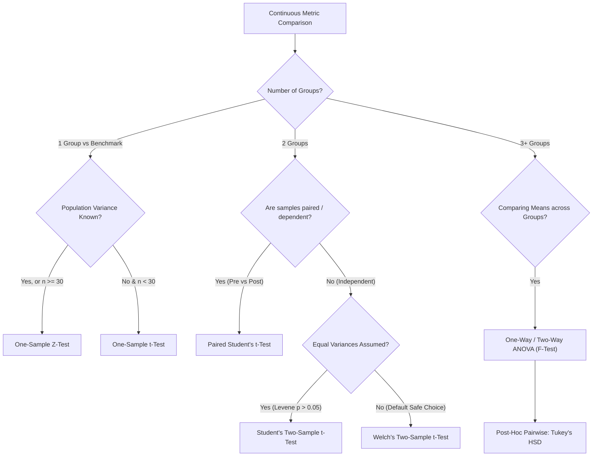

# Hypothesis Testing & Statistical Inference for Enterprise Analytics

**Target Role:** Data Scientist / Associate Data Scientist | Tredence Analytics  
**Context:** IIT Kanpur Placement Season 2026–27  
**Prerequisites:** Probability Foundations, Central Limit Theorem, Sampling Distributions

---

## 1. The Classical Hypothesis Testing Framework

Hypothesis testing is an evidentiary decision framework under uncertainty.

$$\begin{aligned}
H_0 &: \text{Null Hypothesis (Default stance: status quo, no effect, zero difference)} \\
H_1 &: \text{Alternative Hypothesis (Research claim: intervention causes non-zero difference)}
\end{aligned}$$

### 1.1 Decision Matrix & Error Typology

| Reality \ Decision | Fail to Reject $H_0$ (Negative) | Reject $H_0$ (Positive) |
|---|---|---|
| **$H_0$ True** (No real effect) | Correct Decision ($1 - \alpha$) | **Type I Error ($\alpha$)** (False Positive) |
| **$H_1$ True** (Real effect exists) | **Type II Error ($\beta$)** (False Negative) | **Statistical Power ($1 - \beta$)** (True Positive) |

- **Significance Level ($\alpha$):** The maximum tolerable probability of committing a Type I error (standard enterprise threshold: $\alpha = 0.05$).
- **Statistical Power ($1 - \beta$):** Probability of correctly detecting a true treatment effect when it genuinely exists (standard enterprise threshold: $1 - \beta \ge 0.80$).
- **Trade-off:** Decreasing $\alpha$ unconditionally increases $\beta$ for a fixed sample size $n$. The only method to simultaneously reduce both $\alpha$ and $\beta$ is to **increase sample size $n$** or **reduce variance $\sigma^2$** (e.g., via CUPED).

---

## 2. Parametric Test Selection Architecture

### 2.1 Welch's Two-Sample $t$-Test (The Enterprise Industry Standard)
When testing whether treatment group mean differs from control group mean ($\mu_T - \mu_C \ne 0$) without assuming equal group variances ($\sigma_T^2 \ne \sigma_C^2$):

$$t = \frac{\bar{X}_T - \bar{X}_C}{\sqrt{\frac{s_T^2}{n_T} + \frac{s_C^2}{n_C}}}$$

**Satterthwaite Effective Degrees of Freedom ($\nu$):**
$$\nu \approx \frac{\left(\frac{s_T^2}{n_T} + \frac{s_C^2}{n_C}\right)^2}{\frac{\left(\frac{s_T^2}{n_T}\right)^2}{n_T - 1} + \frac{\left(\frac{s_C^2}{n_C}\right)^2}{n_C - 1}}$$

*Why Welch's over Student's $t$ in Business?* In digital experimentation, treatment and control variants almost never have identical sample sizes or identical variances due to traffic routing, unequal dropout, or metric volatility. Student's pooled $t$-test suffers severe Type I error inflation when variances differ; Welch's test remains robust.

### 2.2 ANOVA and the $F$-Distribution
For $k$ independent groups, ANOVA tests $H_0: \mu_1 = \mu_2 = \dots = \mu_k$:
$$F = \frac{\text{Mean Square Between (MSB)}}{\text{Mean Square Within (MSW)}} = \frac{\text{SSB} / (k - 1)}{\text{SSW} / (N - k)}$$
If $F > F_{\text{crit}}$, reject $H_0$. To isolate which pairs differ without Type I error explosion, apply **Tukey's Honestly Significant Difference (HSD)**:
$$\text{HSD} = q_{\alpha, k, N-k} \sqrt{\frac{\text{MSW}}{n}}$$

---

## 3. Categorical Tests: $\chi^2$ (Chi-Square)

### 3.1 $\chi^2$ Test of Independence
Used for contingency tables (e.g., promotional banner click vs no-click across 3 geographic regions):

$$\chi^2 = \sum_{i=1}^r \sum_{j=1}^c \frac{(O_{ij} - E_{ij})^2}{E_{ij}}, \quad df = (r - 1)(c - 1)$$

Where the expected cell frequency under independence assumption is:
$$E_{ij} = \frac{R_i \times C_j}{N}$$
*(Condition: $E_{ij} \ge 5$ in at least 80% of cells; otherwise use Fisher's Exact Test).*

---

## 4. Non-Parametric Tests (Distribution-Free)

When data violates normality assumptions (e.g., highly skewed revenue, extreme outliers, rank-order ratings):

| Parametric Test | Non-Parametric Equivalent | Null Hypothesis | Practical Application |
|---|---|---|---|
| Independent Two-Sample $t$-Test | **Mann-Whitney $U$ Test** (Wilcoxon Rank-Sum) | Distributions are identical ($P(X > Y) = 0.5$) | Comparing session duration or skew revenue per user |
| Paired $t$-Test | **Wilcoxon Signed-Rank Test** | Median difference between paired observations is zero | Pre vs post customer satisfaction scores |
| One-Way ANOVA | **Kruskal-Wallis $H$-Test** | Medians of all $k$ groups are equal | Comparing customer ratings across 4 retail store layouts |
| Pearson Correlation $r$ | **Spearman's Rank Correlation $\rho$** | Monotonic relationship between ranked variables is zero | Engagement rank vs purchase tier correlation |

---

## 5. The Multiple Testing Problem

Testing $m$ independent hypotheses simultaneously at significance level $\alpha = 0.05$:
$$\text{Family-Wise Error Rate (FWER)} = 1 - (1 - \alpha)^m$$
For $m = 20$ tests: $\text{FWER} = 1 - (0.95)^{20} = 1 - 0.3585 = 0.6415 \ (64.2\%)$ chance of at least one false positive.

### 5.1 Corrections
1. **Bonferroni Correction (FWER Control):**
   $$\alpha_{\text{adjusted}} = \frac{\alpha}{m}$$
   *Critique:* Extremely conservative; severely reduces statistical power ($1 - \beta$), missing real commercial gains.
2. **Benjamini-Hochberg Procedure (False Discovery Rate - FDR Control):**
   Controls the expected proportion of false discoveries $Q = \frac{\text{False Positives}}{\text{Total Discoveries}}$:
   - Rank $m$ observed $p$-values in ascending order: $p_{(1)} \le p_{(2)} \le \dots \le p_{(m)}$.
   - Find the largest index $k$ such that:
     $$p_{(k)} \le \frac{k}{m} \times Q$$
   - Reject all null hypotheses $H_{(1)}, \dots, H_{(k)}$.
   *Enterprise Standard:* Preferred in feature selection, gene expression, and multi-metric A/B testing dashboards.

---

## 6. Effect Size and Practical Significance

A minute, commercially trivial difference can achieve a statistically significant $p < 0.001$ with large sample sizes ($n = 10^6$). Always report **Effect Size**:

**Cohen's $d$ (Standardized Mean Difference):**
$$d = \frac{\bar{X}_1 - \bar{X}_2}{s_{\text{pooled}}}, \quad \text{where } s_{\text{pooled}} = \sqrt{\frac{(n_1 - 1)s_1^2 + (n_2 - 1)s_2^2}{n_1 + n_2 - 2}}$$
- $d = 0.2$: Small effect
- $d = 0.5$: Medium effect
- $d = 0.8$: Large effect

*The Tredence "Last-Mile" Principle:* Statistical significance ($p < 0.05$) answers *"Is there an effect?"*; Practical significance (Minimum Detectable Effect & Business Case ROI) answers *"Is the effect worth deploying?"*.
