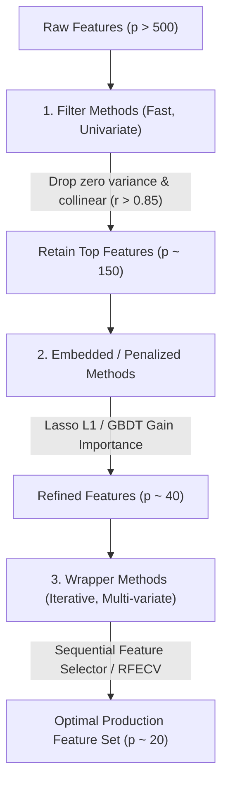

# Feature Engineering, Selection, and Leakage Prevention

**Target Role:** Data Scientist / Associate Data Scientist | Tredence Analytics  
**Context:** IIT Kanpur Placement Season 2026–27  
**Prerequisites:** Scikit-Learn Pipelines, Information Theory, Exploratory Data Analysis

---

## 1. Categorical Encoding Strategies

### 1.1 Encoding Taxonomy & Cardinality Trade-offs

| Method | Cardinality Fit | Dimensionality Impact | Key Risk / Drawback | Ideal Enterprise Use Case |
|---|---|---|---|---|
| **One-Hot Encoding** | Low ($< 10$ unique) | Increases by $K$ (or $K-1$) | High memory, tree split degradation | Low-cardinality nominals (Gender, Region) |
| **Ordinal Encoding** | Any | None (1 column) | Imposes artificial Euclidean order | Explicit hierarchy (Education, Credit Rating) |
| **Target (Mean) Encoding** | High ($> 100$ unique) | None (1 column) | Severe target leakage & overfitting | Store ID, Zip Code, Product SKU in GBDT |
| **Weight of Evidence (WoE)** | Moderate/High | None (1 column) | Requires monotonic binning | Risk modeling, Credit scoring, Propensity |

### 1.2 Smoothed Target Encoding (Empirical Bayes Formulation)
Unregularized mean target encoding causes severe overfitting on small categories (e.g., a store with 1 customer who churned gets encoded as $1.0$).
Apply **Micci-Barreca / Empirical Bayes Smoothing**:

$$\hat{S}_i = \lambda(n_i) \cdot \bar{y}_i + (1 - \lambda(n_i)) \cdot \bar{y}_{\text{global}}$$

Where weighting function $\lambda(n_i)$ is parameterized by smoothing factor $m$:
$$\lambda(n_i) = \frac{n_i}{n_i + m} \implies \hat{S}_i = \frac{n_i \bar{y}_i + m \bar{y}_{\text{global}}}{n_i + m}$$
- As category count $n_i \to \infty$, weight shifts entirely to category empirical mean $\bar{y}_i$.
- For rare categories ($n_i \to 0$), weight defaults to global population base rate $\bar{y}_{\text{global}}$.
- **Crucial Rule:** Must be computed strictly **Out-of-Fold (OOF)** via $K$-Fold cross-validation within the training split.

### 1.3 Weight of Evidence (WoE) and Information Value (IV)
For binary classification (Event vs Non-Event):
$$\text{WoE}_i = \ln\left(\frac{P(X = x_i \mid y = 1)}{P(X = x_i \mid y = 0)}\right) = \ln\left(\frac{\text{Bad}_i / \text{Bad}_{\text{total}}}{\text{Good}_i / \text{Good}_{\text{total}}}\right)$$
$$\text{Information Value (IV)} = \sum_{i=1}^k \left(\frac{\text{Bad}_i}{\text{Bad}_{\text{total}}} - \frac{\text{Good}_i}{\text{Good}_{\text{total}}}\right) \times \text{WoE}_i$$

*IV Predictive Power Benchmark:*
- $\text{IV} < 0.02$: Useless for prediction.
- $0.02 \le \text{IV} < 0.1$: Weak predictor.
- $0.1 \le \text{IV} < 0.3$: Medium predictor.
- $0.3 \le \text{IV} < 0.5$: Strong predictor.
- $\text{IV} \ge 0.5$: Suspiciously high; inspect for direct target leakage!

---

## 2. Outlier Detection and Treatment

1. **Tukey's Interquartile Range (IQR) Rule:**
   $$\text{Lower Fence} = Q_1 - 1.5 \times \text{IQR}, \quad \text{Upper Fence} = Q_3 + 1.5 \times \text{IQR}$$
2. **Modified Z-Score (Robust to Outliers via Median Absolute Deviation):**
   $$M_i = \frac{0.6745 \cdot (x_i - \text{median}(X))}{\text{MAD}(X)}, \quad \text{where } \text{MAD} = \text{median}(|x_i - \text{median}(X)|)$$
   Flag as outlier if $|M_i| > 3.5$.
3. **Treatment Philosophy:**
   - **Never delete outliers in business datasets** unless verified as instrumentation bugs. Real outliers (e.g., massive B2B orders) carry genuine commercial value.
   - **Winsorization / Capping:** Cap extreme values at 1st and 99th percentiles.
   - **Log1p Transform:** $y = \ln(1 + x)$ compresses heavy right tails for linear models.

---

## 3. Missing Data Imputation Framework

```
Missingness Mechanism (Donald Rubin Taxonomy):
├── MCAR (Missing Completely at Random) ──> Unrelated to any observed/unobserved variable (e.g., network drop)
├── MAR (Missing at Random) ──────────────> Related to observed covariates (e.g., older users skip mobile survey)
└── MNAR (Missing Not at Random) ─────────> Related to unobserved value itself (e.g., high earners skip income field)
```

**Production Rules:**
1. **Always add a binary Missingness Indicator column:** `is_missing_feature_A = df['feature_A'].isna().astype(int)`. In MNAR scenarios, the fact that data is missing is itself a predictive signal.
2. **Mean/Median Imputation:** Fit on training split only; transform test set. Median is preferred for skewed continuous metrics.
3. **IterativeImputer (MICE):** Models each missing feature as a function of all other features via round-robin ridge or tree regression.

---

## 4. Feature Selection Architecture



### 4.1 Filter vs Wrapper vs Embedded

- **Filter Methods:** Fast, independent of model (VarianceThreshold, Pearson correlation, Mutual Information). Mutual Information captures non-linear relationships:
  $$I(X; Y) = \iint p(x, y) \ln\left(\frac{p(x, y)}{p(x)p(y)}\right) dx \, dy$$
- **Wrapper Methods:** Evaluates subsets using actual model performance (RFE, Boruta). High computational cost $\mathcal{O}(2^p)$, risk of overfitting validation split.
- **Embedded Methods:** Feature selection occurs naturally during model training (L1 Lasso zero coefficients, LightGBM feature gain).

---

## 5. Data Leakage: Prevention & Defense

Data leakage occurs when information from outside the training dataset is mistakenly used to create the model, producing artificially inflated validation scores that fail in production.

### 5.1 The 3 Cardinal Forms of Leakage

| Leakage Type | Mechanism | Concrete Enterprise Failure | Defense Architecture |
|---|---|---|---|
| **Target Leakage** | Feature contains information that is only available *after* the target event occurs. | Using `cancellation_survey_code` or `refund_amount` to predict churn. | Strict feature timestamp audit: every feature must be physically available at decision time $t_0$. |
| **Train-Test Contamination** | Preprocessing transformations are fit on the full dataset before splitting. | Standardizing using full dataset mean/std, or fitting Target Encoder before train-test split. | Enclose all preprocessing within `sklearn.pipeline.Pipeline`. Never call `.fit()` on validation/test data. |
| **Temporal Lookahead Bias** | Using future observations to predict past/current events in time-series data. | Random $K$-Fold cross-validation on time-series records (e.g., training on 2024 to predict 2023). | Enforce **TimeSeriesSplit** or Expanding Walk-Forward Validation. |

### 5.2 Leakage-Proof Scikit-Learn Pipeline Template

```python
from sklearn.pipeline import Pipeline
from sklearn.compose import ColumnTransformer
from sklearn.impute import SimpleImputer
from sklearn.preprocessing import StandardScaler, OneHotEncoder
import lightgbm as lgb

numeric_features = ['tenure_months', 'monthly_charges', 'data_usage_gb']
categorical_features = ['contract_type', 'payment_method', 'device_category']

numeric_transformer = Pipeline(steps=[
    ('imputer', SimpleImputer(strategy='median')),
    ('scaler', StandardScaler())
])

categorical_transformer = Pipeline(steps=[
    ('imputer', SimpleImputer(strategy='constant', fill_value='missing')),
    ('encoder', OneHotEncoder(handle_unknown='ignore', drop='first'))
])

preprocessor = ColumnTransformer(transformers=[
    ('num', numeric_transformer, numeric_features),
    ('cat', categorical_transformer, categorical_features)
])

# Complete Leak-Proof Pipeline
production_pipeline = Pipeline(steps=[
    ('preprocessor', preprocessor),
    ('classifier', lgb.LGBMClassifier(random_state=42))
])

# pipeline.fit(X_train, y_train) fits transformers ONLY on X_train!
```
