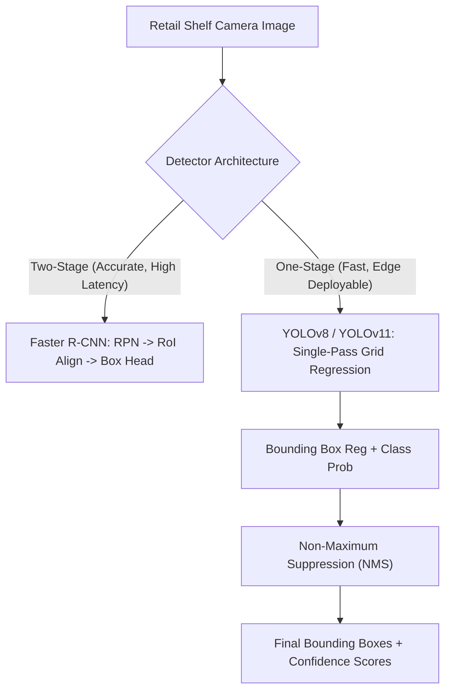

# Computer Vision & Enterprise Retail Image Analytics

**Target Role:** Data Scientist / Associate Data Scientist | Tredence Analytics  
**Context:** IIT Kanpur Placement Season 2026–27  
**Prerequisites:** Convolutions, Deep Learning Foundations, Matrix Operations

---

## 1. Convolutional Mechanics & Receptive Fields

### 1.1 The 2D Convolution (Cross-Correlation) Operation
For input image $\mathbf{I} \in \mathbb{R}^{H \times W \times C_{\text{in}}}$ and kernel $\mathbf{K} \in \mathbb{R}^{k \times k \times C_{\text{in}} \times C_{\text{out}}}$:

$$(\mathbf{I} * \mathbf{K})(x, y, c_{\text{out}}) = \sum_{c=1}^{C_{\text{in}}} \sum_{i=-m}^m \sum_{j=-m}^m \mathbf{I}(x + i, y + j, c) \cdot \mathbf{K}(i + m, j + m, c, c_{\text{out}})$$

**Output Spatial Dimension Formula:**
$$H_{\text{out}} = \left\lfloor \frac{H_{\text{in}} - k + 2p}{s} \right\rfloor + 1$$
Where $k$ is kernel size, $p$ is padding, and $s$ is stride.
- **Valid Padding ($p = 0$):** Image shrinks.
- **Same Padding ($p = \frac{k - 1}{2}$ for odd $k$):** Preserves spatial dimensions when $s = 1$.

### 1.2 Receptive Field
The spatial area in the input image that directly influences a specific neuron in layer $l$:
$$RF_l = RF_{l-1} + (k_l - 1) \cdot \prod_{i=1}^{l-1} s_i$$
To capture large retail objects or full store shelves without blowing up parameter counts, architectures utilize **Dilated Convolutions** or multi-scale feature pyramids (FPN).

---

## 2. Key Vision Architectures

### 2.1 ResNet: The Residual Skip Connection (He et al., 2015)
In plain networks, stacking $> 20$ layers leads to degradation (training error increases due to gradient vanishing/shattering).

$$\mathbf{y} = \mathcal{F}(\mathbf{x}, \{W_i\}) + \mathbf{x}$$
- By learning residual mapping $\mathcal{F}(\mathbf{x}) = \mathcal{H}(\mathbf{x}) - \mathbf{x}$, if identity mapping is optimal, weights simply push to zero $\mathcal{F}(\mathbf{x}) \to \mathbf{0}$.
- **Gradient Highway:** $\frac{\partial \mathcal{L}}{\partial \mathbf{x}} = \frac{\partial \mathcal{L}}{\partial \mathbf{y}} \left(\frac{\partial \mathcal{F}}{\partial \mathbf{x}} + \mathbf{I}\right)$. The identity term $+ \mathbf{I}$ ensures gradients propagate directly to shallow layers without diminishing.

### 2.2 Vision Transformers (ViT - Dosovitskiy et al., 2020)
- Splits image into fixed $16 \times 16$ non-overlapping patches.
- Linearly projects flattened patches into 1D token embeddings.
- Prepend learnable `[CLS]` token and add 1D learnable position embeddings.
- Processes tokens through standard Transformer encoder blocks.
- **Trade-off:** Lacks inductive bias of CNNs (translation invariance and locality); requires large-scale pretraining (e.g., ImageNet-21k), but excels at global context understanding.

---

## 3. Object Detection Paradigms

### 3.1 Intersection over Union (IoU) & Non-Maximum Suppression (NMS)
$$\text{IoU} = \frac{\text{Area of Overlap}(B_{\text{pred}} \cap B_{\text{gt}})}{\text{Area of Union}(B_{\text{pred}} \cup B_{\text{gt}})}$$

**Greedy NMS Algorithm:**
1. Sort all predicted boxes by classification confidence score descending.
2. Select box with highest confidence $M$; output it as a verified detection.
3. Compute IoU between $M$ and all remaining candidate boxes.
4. Suppress (discard) any box with $\text{IoU} > \text{threshold}$ (typically $0.45 - 0.50$).
5. Repeat until no candidate boxes remain.

---

## 4. Enterprise Retail Vision Applications at Tredence

1. **On-Shelf Availability (OSA) & Out-of-Stock Detection:**
   - Autonomous robotic or fixed shelf cameras photograph grocery aisles.
   - YOLO models detect individual product SKUs and identify empty shelf slots (void detection) in real time.
2. **Planogram Compliance:**
   - Compares physical shelf arrangement against brand master schematics.
   - Calculates **Share of Shelf (SoS)** for client CPG brands vs competitors.
3. **Automated Defect & Foreign Object Inspection:**
   - Vision models deployed at high-speed bottling or packaging lines flagging label tearing, seal leakage, or dented cans.
