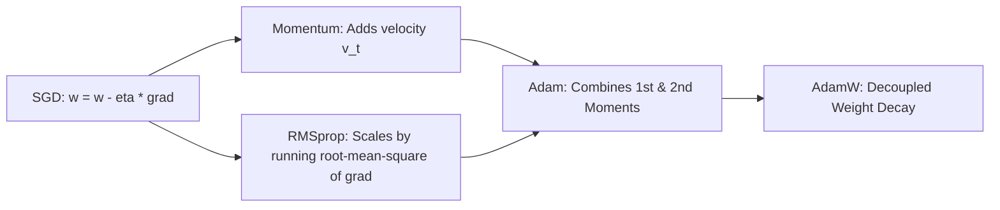

# Deep Learning Foundations, Optimization, and Architectures

**Target Role:** Data Scientist / Associate Data Scientist | Tredence Analytics  
**Context:** IIT Kanpur Placement Season 2026–27  
**Prerequisites:** Multivariable Calculus (Chain Rule), Linear Algebra, Optimization

---

## 1. Multilayer Perceptron (MLP) & Forward Propagation

Given layer $l \in \{1, \dots, L\}$ with input $\mathbf{a}^{[l-1]} \in \mathbb{R}^{n_{l-1}}$:

$$\mathbf{z}^{[l]} = \mathbf{W}^{[l]} \mathbf{a}^{[l-1]} + \mathbf{b}^{[l]}$$
$$\mathbf{a}^{[l]} = g^{[l]}(\mathbf{z}^{[l]})$$

Where $\mathbf{W}^{[l]} \in \mathbb{R}^{n_l \times n_{l-1}}$, $\mathbf{b}^{[l]} \in \mathbb{R}^{n_l}$, and $g^{[l]}(\cdot)$ is a non-linear activation function.

---

## 2. Activation Functions: Properties & Derivatives

| Activation Function | Formula $g(z)$ | Derivative $g'(z)$ | Range | Key Trade-offs |
|---|---|---|---|---|
| **Sigmoid** | $\frac{1}{1 + e^{-z}}$ | $g(z)(1 - g(z))$ | $(0, 1)$ | Vanishing gradient ($g' \le 0.25$); not zero-centered. |
| **Tanh** | $\frac{e^z - e^{-z}}{e^z + e^{-z}}$ | $1 - g(z)^2$ | $(-1, 1)$ | Zero-centered, but saturates and vanishes at tails. |
| **ReLU** | $\max(0, z)$ | $\mathbb{I}(z > 0)$ | $[0, \infty)$ | Computationally fast, no saturation for $z > 0$; suffers from **Dying ReLU** for $z \le 0$. |
| **Leaky ReLU** | $\max(\alpha z, z), \ \alpha = 0.01$ | $1 \ (z > 0), \ \alpha \ (z \le 0)$ | $(-\infty, \infty)$ | Solves dying ReLU by maintaining non-zero gradient everywhere. |
| **GeLU** | $z \Phi(z) \approx 0.5z[1 + \tanh(\sqrt{2/\pi}(z + 0.044715z^3))]$ | Smooth curve | $(-0.17, \infty)$ | Probabilistic gating; standard in Transformers (BERT, GPT). |

---

## 3. Backpropagation: Vectorized Chain Rule Derivation

Let loss be $\mathcal{L}(\hat{\mathbf{y}}, \mathbf{y})$. Define error vector $\boldsymbol{\delta}^{[l]} = \frac{\partial \mathcal{L}}{\partial \mathbf{z}^{[l]}}$:

1. **Output Layer Error ($L$):**
   $$\boldsymbol{\delta}^{[L]} = \nabla_{\mathbf{a}^{[L]}} \mathcal{L} \odot {g^{[L]}}'(\mathbf{z}^{[L]})$$
   *(For Softmax with Cross-Entropy Loss: $\boldsymbol{\delta}^{[L]} = \hat{\mathbf{y}} - \mathbf{y}$)*.
2. **Backpropagating Error to Hidden Layer ($l$):**
   $$\boldsymbol{\delta}^{[l]} = \left( (\mathbf{W}^{[l+1]})^T \boldsymbol{\delta}^{[l+1]} \right) \odot {g^{[l]}}'(\mathbf{z}^{[l]})$$
3. **Weight & Bias Gradients:**
   $$\frac{\partial \mathcal{L}}{\partial \mathbf{W}^{[l]}} = \boldsymbol{\delta}^{[l]} (\mathbf{a}^{[l-1]})^T, \quad \frac{\partial \mathcal{L}}{\partial \mathbf{b}^{[l]}} = \boldsymbol{\delta}^{[l]}$$

---

## 4. Modern Optimization Algorithms

### 4.1 AdamW (Loshchilov & Hutter, 2017)
Standard Adam with $L_2$ regularization mistakenly includes the regularization gradient in the second moment accumulator $v_t$, which disproportionately suppresses regularization for parameters with frequent large gradients.

**AdamW Algorithm:**
1. Gradient: $\mathbf{g}_t = \nabla_\theta f_t(\theta_{t-1})$.
2. First moment (momentum): $\mathbf{m}_t = \beta_1 \mathbf{m}_{t-1} + (1 - \beta_1)\mathbf{g}_t$.
3. Second moment (adaptive variance): $\mathbf{v}_t = \beta_2 \mathbf{v}_{t-1} + (1 - \beta_2)\mathbf{g}_t^2$.
4. Bias correction: $\hat{\mathbf{m}}_t = \frac{\mathbf{m}_t}{1 - \beta_1^t}, \quad \hat{\mathbf{v}}_t = \frac{\mathbf{v}_t}{1 - \beta_2^t}$.
5. **Decoupled Weight Update (AdamW):**
   $$\theta_t = \theta_{t-1} - \eta_t \lambda \theta_{t-1} - \frac{\eta_t}{\sqrt{\hat{\mathbf{v}}_t} + \epsilon} \hat{\mathbf{m}}_t$$
   *(The weight decay $\lambda \theta_{t-1}$ is subtracted directly outside the adaptive learning rate term)*.

---

## 5. Regularization & Normalization

### 5.1 Batch Normalization (BN) vs Layer Normalization (LN)
- **Batch Normalization (Ioffe & Szegedy, 2015):** Normalizes across the **mini-batch dimension** for each channel independently:
  $$\hat{x}_i = \frac{x_i - \mu_B}{\sqrt{\sigma_B^2 + \epsilon}}, \quad y_i = \gamma \hat{x}_i + \beta$$
  *Drawback:* Fails when batch size $B$ is small ($B < 8$) or variable-length sequences.
- **Layer Normalization (Ba, Kiros, Hinton, 2016):** Normalizes across the **feature/channel dimension** for each observation independently:
  - Independent of batch size.
  - Mandatory standard for RNNs, Transformers, and LLMs.

### 5.2 Vanishing / Exploding Gradients & Weight Initialization
In deep networks of $L$ layers, gradients involve repeated matrix products $\prod_{l=1}^L \mathbf{W}^{[l]}$:
- If eigenvalues of $\mathbf{W} < 1$, gradient vanishes exponentially ($\to 0$).
- If eigenvalues of $\mathbf{W} > 1$, gradient explodes exponentially ($\to \infty$).

**Solutions:**
1. **He (Kaiming) Initialization (for ReLU):** $\mathbf{W} \sim \mathcal{N}\left(0, \sqrt{\frac{2}{n_{\text{in}}}}\right)$.
2. **Xavier (Glorot) Initialization (for Tanh/Sigmoid):** $\mathbf{W} \sim \mathcal{N}\left(0, \sqrt{\frac{2}{n_{\text{in}} + n_{\text{out}}}}\right)$.
3. **Gradient Clipping:** If $\|\mathbf{g}\|_2 > c$, rescale: $\mathbf{g} \leftarrow c \frac{\mathbf{g}}{\|\mathbf{g}\|_2}$.
4. **Residual Skip Connections:** $\mathbf{a}^{[l+1]} = g(\mathbf{z}^{[l+1]} + \mathbf{a}^{[l]})$, allowing gradients to flow back directly via identity addition.
