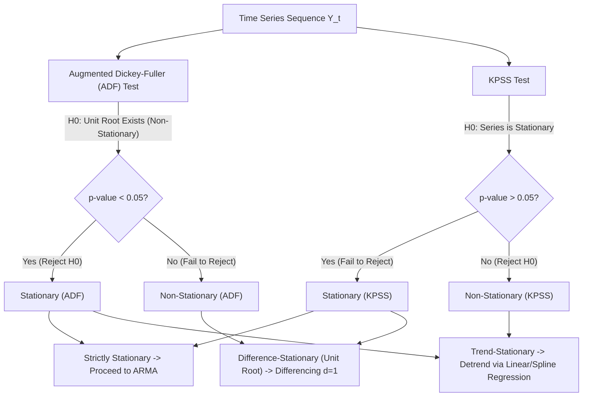

# Time-Series Modeling, Stochastic Processes, and Demand Forecasting

**Target Role:** Data Scientist / Associate Data Scientist | Tredence Analytics  
**Context:** IIT Kanpur Placement Season 2026–27  
**Prerequisites:** Stochastic Processes, Autoregressive Models, Fourier / Spectral Analysis  
**Candidate Synergy Anchor:** Direct mathematical transference from hydrological streamflow stochastic time-series and extreme flood recurrence modeling to retail demand volatility.

---

## 1. Time-Series Foundations & Stationarity

A time series $\{Y_t\}_{t \in \mathbb{Z}}$ is **Weakly Stationary (Second-Order Stationary)** if:
1. **Constant Mean:** $\mathbb{E}[Y_t] = \mu \quad \forall t$
2. **Finite & Constant Variance:** $\text{Var}(Y_t) = \sigma^2 < \infty \quad \forall t$
3. **Autocovariance depends only on lag $k$:**
   $$\gamma(k) = \text{Cov}(Y_t, Y_{t-k}) = \mathbb{E}[(Y_t - \mu)(Y_{t-k} - \mu)] = \gamma(-k)$$

### 1.1 Stationarity Testing: ADF vs KPSS



- **Augmented Dickey-Fuller (ADF) Equation:**
  $$\Delta Y_t = \alpha + \beta t + \gamma Y_{t-1} + \sum_{i=1}^p \delta_i \Delta Y_{t-i} + \epsilon_t$$
  $H_0: \gamma = 0$ (Unit root present; non-stationary) vs $H_1: \gamma < 0$ (Stationary).

---

## 2. Autocorrelation & Partial Autocorrelation

- **Autocorrelation Function (ACF) $\rho_k$:** Measures linear correlation between $Y_t$ and $Y_{t-k}$, including indirect pathways through intermediate lags $t-1, \dots, t-k+1$:
  $$\rho_k = \frac{\gamma(k)}{\gamma(0)} = \frac{\text{Cov}(Y_t, Y_{t-k})}{\text{Var}(Y_t)}$$
- **Partial Autocorrelation Function (PACF) $\phi_{kk}$:** Measures the pure correlation between $Y_t$ and $Y_{t-k}$ after partialling out the linear influence of all intermediate lags $Y_{t-1}, \dots, Y_{t-k+1}$.

### 2.1 Order Identification Rules

| Process | ACF Behavior | PACF Behavior |
|---|---|---|
| **$\text{AR}(p)$** | Tails off exponentially or damped sine wave | **Cuts off sharply after lag $p$** |
| **$\text{MA}(q)$** | **Cuts off sharply after lag $q$** | Tails off exponentially or damped sine wave |
| **$\text{ARMA}(p, q)$** | Tails off after lag $q$ | Tails off after lag $p$ |

---

## 3. The ARIMA & SARIMA Framework

### 3.1 Mathematical Formulation of $\text{SARIMA}(p, d, q) \times (P, D, Q)_s$
Using the backshift (lag) operator $B$, where $B^k Y_t = Y_{t-k}$:

$$\Phi_P(B^s) \phi_p(B) (1 - B)^d (1 - B^s)^D Y_t = \Theta_Q(B^s) \theta_q(B) \epsilon_t$$

Where:
- $\phi_p(B) = 1 - \sum_{i=1}^p \phi_i B^i$ (Non-seasonal AR operator).
- $\theta_q(B) = 1 + \sum_{j=1}^q \theta_j B^j$ (Non-seasonal MA operator).
- $\Phi_P(B^s) = 1 - \sum_{i=1}^P \Phi_i B^{is}$ (Seasonal AR operator, period $s$).
- $\Theta_Q(B^s) = 1 + \sum_{j=1}^Q \Theta_j B^{js}$ (Seasonal MA operator, period $s$).
- $d$: Degree of regular differencing; $D$: Degree of seasonal differencing; $s$: Seasonal period (e.g., $s=7$ for daily data with day-of-week cycle; $s=12$ for monthly).

---

## 4. Time-Series Validation: Walk-Forward Cross-Validation

Standard random $K$-Fold cross-validation destroys the temporal dependency structure and introduces severe lookahead leakage.

```
 Fold 1: [ Train: Weeks 1-20  ] -> [ Test: Weeks 21-24 ]
 Fold 2: [ Train: Weeks 1-24          ] -> [ Test: Weeks 25-28 ]
 Fold 3: [ Train: Weeks 1-28                  ] -> [ Test: Weeks 29-32 ]
 Fold 4: [ Train: Weeks 1-32                          ] -> [ Test: Weeks 33-36 ]
```

- **Expanding Window (Rolling Origin):** Training split expands forward over time while maintaining fixed forecast horizon $h$.
- **Sliding Window:** Training window size remains fixed (e.g., past 52 weeks) and slides forward, dropping oldest historical records to adapt to rapid concept drift.

---

## 5. Enterprise Demand Forecasting & Hierarchical Reconciliation

In retail and CPG analytics (Tredence's core), forecasting is not done on a single isolated series; it operates on a hierarchical tree:
$$\text{Total Brand Demand} \to \text{Regional Warehouses} \to \text{Individual Stores} \to \text{SKUs}$$

### 5.1 Reconciliation Approaches
1. **Bottom-Up:** Forecast at SKU-Store level; aggregate up the hierarchy. Captures micro-dynamics, but high variance on intermittent, sparse demand.
2. **Top-Down:** Forecast at national/category level; disaggregate down using historical proportions. Smooth and low variance, but misses localized store promotions.
3. **Optimal Reconciliation (MinT - Minimum Trace, Hyndman et al.):** Uses generalized least squares to reconcile forecasts across all levels simultaneously:
   $$\tilde{\mathbf{y}}_t = \mathbf{S} (\mathbf{S}^T \mathbf{W}^{-1} \mathbf{S})^{-1} \mathbf{S}^T \mathbf{W}^{-1} \hat{\mathbf{y}}_t$$
   Where $\mathbf{S}$ is the structural summing matrix and $\mathbf{W}$ is the forecast error covariance matrix.

---

## 6. Production Python Implementation Template

```python
import numpy as np
import pandas as pd
from statsmodels.tsa.statespace.sarimax import SARIMAX
from statsmodels.tsa.stattools import adfuller

def fit_retail_demand_forecast(ts_series: pd.Series, order=(1, 1, 1), seasonal_order=(1, 1, 1, 7), forecast_horizon=14):
    """
    Fits SARIMAX on daily retail SKU demand and forecasts next 14 days.
    """
    # 1. Stationarity Check
    adf_result = adfuller(ts_series.dropna())
    adf_pvalue = adf_result[1]
    
    # 2. Fit SARIMA Model
    model = SARIMAX(
        ts_series,
        order=order,
        seasonal_order=seasonal_order,
        enforce_stationarity=False,
        enforce_invertibility=False
    )
    fitted_model = model.fit(disp=False)
    
    # 3. Out-of-Sample Forecast with Confidence Intervals
    forecast_obj = fitted_model.get_forecast(steps=forecast_horizon)
    forecast_df = pd.DataFrame({
        'forecast': forecast_obj.predicted_mean,
        'ci_lower': forecast_obj.conf_int().iloc[:, 0],
        'ci_upper': forecast_obj.conf_int().iloc[:, 1]
    })
    
    return {
        'model_summary': fitted_model.summary(),
        'forecast_df': forecast_df,
        'aic': fitted_model.aic,
        'bic': fitted_model.bic,
        'adf_pvalue': adf_pvalue
    }
```
