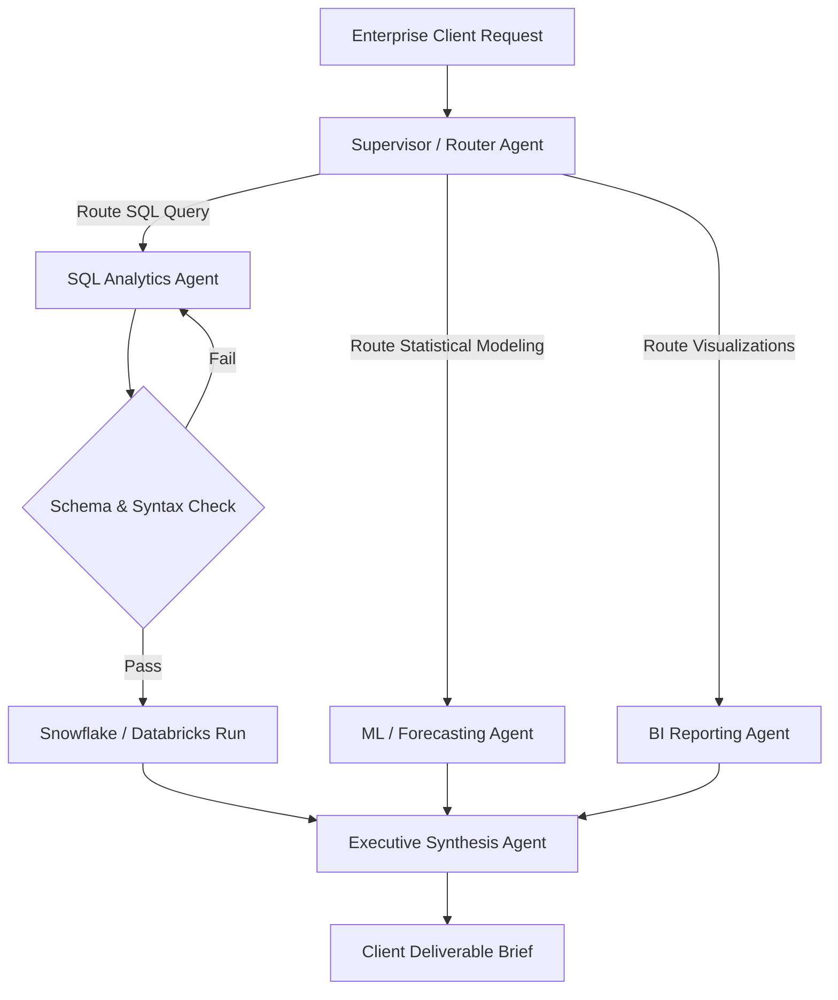

# Autonomous AI Agents & Multi-Agent Systems

**Target Role:** Data Scientist / Associate Data Scientist | Tredence Analytics  
**Context:** IIT Kanpur Placement Season 2026–27  
**Prerequisites:** Prompt Engineering, Tool/Function Calling, LLM Reasoning Paradigms

---

## 1. The Autonomous Agent Cognitive Architecture

An autonomous AI agent extends static LLMs by coupling language generation with dynamic planning, tool invocation, and persistent state memory.

```
                    ┌────────────────────────────────────────────────────────┐
                    │                    Agent Orchestrator                  │
                    │  ┌─────────────────┐ ┌───────────────┐ ┌────────────┐  │
Perception ─────────┼─>│ Working Memory  │ │  Reasoning    │ │ Tool Engine│  │
(Query / Event)     │  │ (Context Buffer)│ │ (ReAct Loop)  │ │ (Functions)│  │
                    │  └────────┬────────┘ └───────┬───────┘ └─────┬──────┘  │
                    └───────────┼──────────────────┼───────────────┼─────────┘
                                │                  │               │
                                v                  v               v
                        Vector DB Memory       Sub-Goals      API / SQL Run
```

### 1.1 Core Components
1. **Perception:** Ingests user input, API events, or multimodal sensory inputs.
2. **Memory:**
   - *Short-Term Memory:* In-context conversational history, immediate scratchpad.
   - *Long-Term Memory:* Vector database storing episodic past experiences, user profile preferences, and entity knowledge graphs.
3. **Planning & Reasoning:** Deconstructs complex objectives into executable milestones.
4. **Action (Tool Use):** Generates structured function calls (JSON Schema) to interact with external databases, APIs, code interpreters, and web search engines.

---

## 2. Agent Reasoning Paradigms

### 2.1 ReAct: Synergizing Reasoning and Acting (Yao et al., ICLR 2023)
Combines chain-of-thought reasoning with real-time environment actions:

```
User Query: "What was our highest-margin product category in Q2 2024, and did it experience supply stockouts?"

Thought 1: I need to query the retail database for category gross margins during Q2 2024.
Action 1: execute_sql_query
Action Input 1: "SELECT category, SUM(gross_margin) as total_margin FROM sales WHERE quarter = 'Q2_2024' GROUP BY category ORDER BY total_margin DESC LIMIT 1;"
Observation 1: {"category": "Organic Dairy", "total_margin": 1420500}

Thought 2: The top category is Organic Dairy. Now I need to check warehouse stockout incident logs for this category in Q2 2024.
Action 2: check_stockout_logs
Action Input 2: {"category": "Organic Dairy", "period": "Q2_2024"}
Observation 2: {"stockout_events": 0, "fill_rate": 0.994}

Thought 3: I have both facts. Organic Dairy led margins at $1.42M and maintained a 99.4% fill rate with zero stockouts.
Final Answer: In Q2 2024, Organic Dairy was our highest-margin category ($1.42M gross margin) and operated smoothly with zero stockout events (99.4% fill rate).
```

### 2.2 Reflexion: Language Agents with Verbal Reinforcement (Shinn et al., 2023)
When an agent's execution fails (e.g., an automated SQL generation produces a database syntax error or zero rows):
1. The agent evaluates the failure signal.
2. It writes a **verbal self-reflection** stored in episodic memory: *"I joined `orders` on `customer_id`, but customer records in 2024 use `account_uuid`. In future queries on 2024 tables, join on `account_uuid`."*
3. The self-reflection is prepended to working memory on subsequent retry iterations, enabling rapid heuristic self-correction without model weight updates.

---

## 3. Multi-Agent Orchestration Patterns



### 3.1 Common Architecture Patterns
1. **Supervisor-Worker Pattern:** A central coordinator breaks high-level goals into subtasks, delegates them to specialized worker agents with dedicated toolsets, and collates results.
2. **Evaluator-Optimizer Loop:** A generator agent creates an artifact (e.g., a churn mitigation business proposal), and a critic/evaluator agent audits it against rigorous business rules and accuracy rubrics. The generator iteratively refines the deliverable.
3. **Human-in-the-Loop (HITL):** Enforces mandatory human approval checkpoints before executing high-stakes, irreversible operations (e.g., executing database write/drop commands, firing automated pricing updates).

---

## 4. Production Function Calling Schema (Pydantic / OpenAI Spec)

```python
from pydantic import BaseModel, Field
from typing import Literal

class CustomerChurnInterventionTool(BaseModel):
    """
    Triggers an automated customer retention offer in the CRM.
    """
    account_id: str = Field(description="Unique 10-digit enterprise account identifier")
    churn_probability: float = Field(description="Model-estimated churn probability between 0 and 1", ge=0.0, le=1.0)
    primary_churn_driver: str = Field(description="Top TreeSHAP feature contributing to churn score")
    offer_tier: Literal["tier_1_rebate", "tier_2_dedicated_csm", "tier_3_contract_renegotiation"] = Field(
        description="Recommended retention action based on customer CLV"
    )

# Generates strict JSON Schema passed to LLM function calling endpoints
tool_schema = CustomerChurnInterventionTool.model_json_schema()
```
