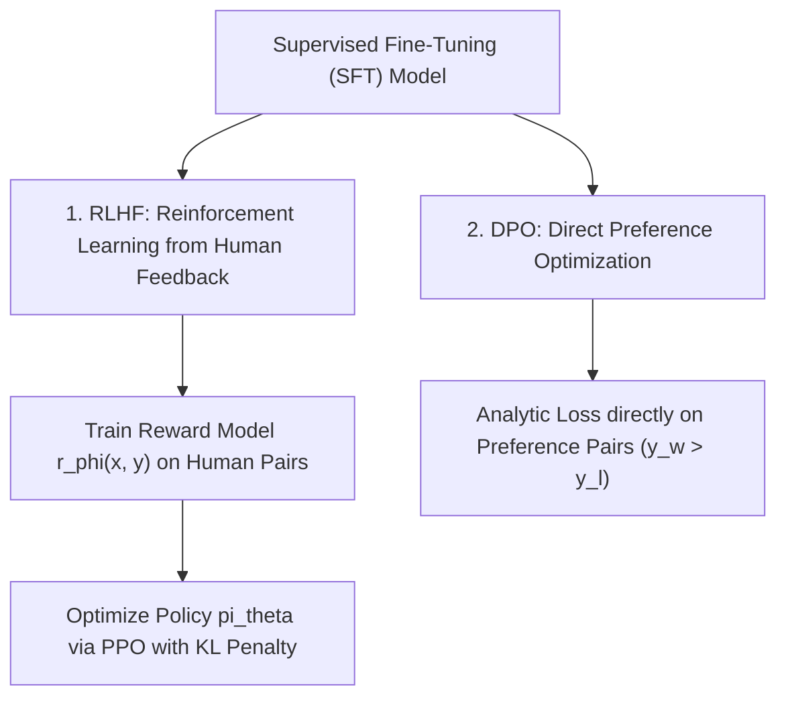

# Large Language Model (LLM) Foundations & Parameter-Efficient Fine-Tuning (PEFT)

**Target Role:** Data Scientist / Associate Data Scientist | Tredence Analytics  
**Context:** IIT Kanpur Placement Season 2026–27  
**Prerequisites:** Transformer Self-Attention, Optimization, Gradient Descent

---

## 1. LLM Architectures: Decoder-Only Dominance

Modern generative LLMs (GPT-4, LLaMA 3, Mistral) utilize **Autoregressive Decoder-Only Transformer** architectures.

```
       Encoder-Only (BERT)             Encoder-Decoder (T5)            Decoder-Only (LLaMA/GPT)
 ┌─────────────────────────────┐ ┌──────────────┬──────────────┐ ┌─────────────────────────────┐
 │ Bidirectional Self-Attention│ │ Encoder (Bi) │ Decoder (Uni)│ │ Causal Masked Self-Attention│
 └─────────────────────────────┘ └──────────────┴──────────────┘ └─────────────────────────────┘
  Ideal for: Classification,      Ideal for: Translation,         Ideal for: Text Generation,
  NER, Vector Embeddings          Summarization                   Reasoning, In-Context Learning
```

### 1.1 Causal Masking
Prevents token $t$ from attending to future tokens $t+1, \dots, T$:
$$\mathbf{M}_{ij} = \begin{cases} 0 & \text{if } i \ge j \\ -\infty & \text{if } i < j \end{cases}$$
$$\text{MaskedAttention}(\mathbf{Q}, \mathbf{K}, \mathbf{V}) = \text{softmax}\left(\frac{\mathbf{Q}\mathbf{K}^T}{\sqrt{d_k}} + \mathbf{M}\right) \mathbf{V}$$

### 1.2 Pretraining Objective: Causal Language Modeling
Maximizes log-likelihood of predicting the next token across a massive corpus:
$$\mathcal{L}_{\text{CLM}}(\theta) = -\sum_{i=1}^T \ln P(x_i \mid x_1, \dots, x_{i-1}; \theta)$$

---

## 2. Parameter-Efficient Fine-Tuning (PEFT)

Full Parameter Fine-Tuning (FPFT) updates all $7\text{B} - 70\text{B}$ weights, requiring massive VRAM ($\sim 16 - 20\text{ bytes per parameter}$ for AdamW optimizer states, gradients, and activations).

### 2.1 LoRA: Low-Rank Adaptation (Hu et al., Microsoft 2021)
Hypothesis: Weight updates $\Delta \mathbf{W}$ during domain adaptation have a low "intrinsic dimension".

For a frozen weight matrix $\mathbf{W}_0 \in \mathbb{R}^{d \times k}$, decompose the update $\Delta \mathbf{W}$ into two low-rank matrices:
$$\mathbf{W} = \mathbf{W}_0 + \Delta \mathbf{W} = \mathbf{W}_0 + \frac{\alpha}{r} (\mathbf{B} \mathbf{A})$$
Where:
- $\mathbf{B} \in \mathbb{R}^{d \times r}$ initialized to **zeros**.
- $\mathbf{A} \in \mathbb{R}^{r \times k}$ initialized with **Gaussian random noise**.
- $r \ll \min(d, k)$ (Rank, typically $r \in \{8, 16, 32, 64\}$).
- $\alpha$: Scaling constant (typically set to $2r$).

```
                Input Vector x (d)
                 /             \
                /               \
         (Frozen W_0)          (A: r x k)  <- Trainable Gaussian
           d x k                    │
             │                 (B: d x r)  <- Trainable Zeros
             │                      │
             \                Scaled by (alpha / r)
              \                    /
               \                  /
                \                /
              (+) Output Vector h (k)
```

**Key Advantages:**
1. Reduces trainable parameters by $> 99.8\%$ (e.g., from 7 billion to 14 million parameters).
2. Frozen $\mathbf{W}_0$ incurs zero gradient storage.
3. No inference latency: during deployment, fold $\frac{\alpha}{r}(\mathbf{B}\mathbf{A})$ directly into $\mathbf{W}_0$ via matrix addition: $\mathbf{W}_{\text{deployed}} = \mathbf{W}_0 + \frac{\alpha}{r}\mathbf{BA}$.

### 2.2 QLoRA (Dettmers et al., 2023)
Enables fine-tuning a 70B parameter LLM on a single 48GB GPU by combining:
1. **NF4 (NormalFloat4) Quantization:** Quantizes frozen weights to an information-theoretically optimal 4-bit representation for normally distributed data.
2. **Double Quantization:** Quantizes quantization constants to save additional memory.
3. **Paged Optimizers:** Offloads memory spikes to CPU RAM during activation peaks.

---

## 3. Post-Training Alignment: RLHF vs DPO



### 3.1 RLHF with PPO
Maximizes expected reward while preventing policy collapse via KL-divergence penalty from the reference SFT model $\pi_{\text{ref}}$:
$$\max_{\pi_\theta} \mathbb{E}_{(x, y) \sim \mathcal{D}} \left[ r_\phi(x, y) \right] - \beta \, \mathbb{D}_{\text{KL}}\left(\pi_\theta(y \mid x) \,\|\, \pi_{\text{ref}}(y \mid x)\right)$$

### 3.2 Direct Preference Optimization (DPO - Rafailov et al., 2023)
RLHF via PPO is notoriously unstable, sensitive to hyperparameters, and requires hosting 4 separate models concurrently in GPU memory (Policy, Reference, Reward, Value).

**DPO Breakthrough:** Analytically reparameterizes the reward function directly in terms of the optimal policy:
$$r(x, y) = \beta \ln\left(\frac{\pi_\theta(y \mid x)}{\pi_{\text{ref}}(y \mid x)}\right) + \beta \ln Z(x)$$
This yields a closed-form binary cross-entropy loss trained directly on pairwise human preference data $(x, y_w, y_l)$ without training a separate reward model or using reinforcement learning:

$$\mathcal{L}_{\text{DPO}}(\theta; \pi_{\text{ref}}) = -\mathbb{E}_{(x, y_w, y_l)} \left[ \ln \sigma\left( \beta \ln \frac{\pi_\theta(y_w \mid x)}{\pi_{\text{ref}}(y_w \mid x)} - \beta \ln \frac{\pi_\theta(y_l \mid x)}{\pi_{\text{ref}}(y_l \mid x)} \right) \right]$$
Where $y_w$ is the preferred winner and $y_l$ is the dispreferred loser.
