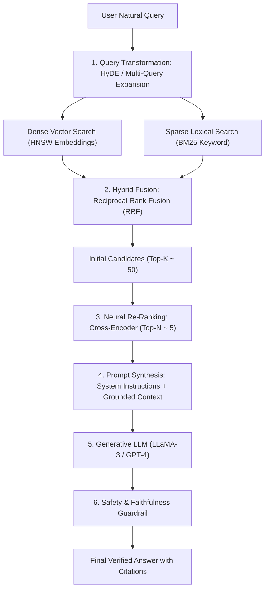

# Production Retrieval-Augmented Generation (RAG) Architecture

**Target Role:** Data Scientist / Associate Data Scientist | Tredence Analytics  
**Context:** IIT Kanpur Placement Season 2026–27  
**Prerequisites:** Vector Embeddings, LLM Prompting, Information Retrieval

---

## 1. The Production RAG Pipeline Architecture



---

## 2. Ingestion & Document Chunking Strategies

The choice of chunking strategy dictates the upper bound of retrieval precision:

| Strategy | Mechanism | Pros | Cons | Ideal Enterprise Use Case |
|---|---|---|---|---|
| **Fixed-Size with Overlap** | Cuts text every $N$ tokens (e.g., 512) with $10\%$ overlap (50 tokens). | Fast, trivial to implement. | Breaks mid-sentence; fragments semantic concepts. | Quick baseline prototypes |
| **Recursive Character** | Hierarchically splits by paragraphs (`\n\n`), then sentences (`\n`), then words. | Preserves grammatical integrity and paragraphs. | Arbitrary length variation. | Unstructured knowledge bases, wikis |
| **Parent Document Retrieval** | Embeds small chunks (100 tokens) for search; retrieves and feeds full parent section (1,000 tokens) to LLM. | Fine-grained vector search without losing surrounding context. | Higher LLM token consumption. | **Enterprise contracts, SOPs, SEC 10-K filings** |
| **Semantic Chunking** | Computes cosine similarity between consecutive sentences; splits where similarity drops below 85th percentile. | Chunks represent semantically coherent thoughts. | Computationally slow ingestion ($O(N)$ embeddings). | Dense technical documentation |

---

## 3. Hybrid Search & Reciprocal Rank Fusion (RRF)

Dense vector search struggles with exact keywords, part numbers, SKU codes, and acronyms (e.g., searching for SKU `XYZ-9821-B` or medical code `ICD-10-CM`). Sparse BM25 excels at exact keyword matching but misses semantic synonyms.

### 3.1 Reciprocal Rank Fusion (RRF - Cormack et al.)
Combines ranked lists from diverse retrieval engines without requiring score normalization:

$$\text{RRF\_Score}(d \in D) = \sum_{m \in M} \frac{1}{k + r_m(d)}$$

Where:
- $M$: Set of retrieval systems (e.g., $M = \{\text{Dense Vector}, \text{BM25}\}$).
- $r_m(d)$: Rank position of document $d$ in retrieval engine $m$ ($1, 2, 3, \dots$).
- $k$: Smoothing constant (industry standard: $k = 60$).

---

## 4. Cross-Encoder Neural Re-Ranking

Dense retrievers (Bi-Encoders) compute query and document embeddings independently to enable fast ANN vector lookups: $\mathbf{e}_q = f(Q), \mathbf{e}_d = f(D)$. However, Bi-Encoders cannot model cross-token interactions between query terms and document text.

```
       Bi-Encoder (Fast Retrieval)                   Cross-Encoder (Accurate Re-Ranking)
 Query Q ──> [ Transformer ] ──> e_q                Query Q ────┐
                                      \ (Cosine)                ├──> [ Full Transformer ] ──> Relevance Score
 Doc D   ──> [ Transformer ] ──> e_d  /             Doc D   ────┘      (All-to-all attention)
```

- **Cross-Encoder Architecture (e.g., Cohere Rerank, BGE-Reranker-v2):** Concatenates $[Q; D]$ into a single sequence and processes it through bidirectional cross-attention layers.
- **Production Pipeline:**
  1. Retrieve Top 50 candidates using fast Hybrid Search (latency $\approx 25\text{ ms}$).
  2. Re-rank Top 50 candidates using Cross-Encoder; select Top 5 (latency $\approx 60\text{ ms}$).
  3. Provides a massive $+15 - 25\%$ boost in NDCG@5 with minimal latency budget impact.

---

## 5. Query Transformation & Expansion

1. **Hypothetical Document Embeddings (HyDE - Gao et al., 2022):**
   - User query is passed to an LLM: *"Write a hypothetical excerpt answering: 'What is our regional return policy for perishable dairy?'"*
   - The generated hypothetical text is embedded into vector space.
   - Vector search on the hypothetical text retrieves real documents with similar semantic structure, bypassing vocabulary mismatch.
2. **Sub-Query Decomposition:**
   - For multi-part queries (e.g., *"Compare Q3 promotional ROI between Store 101 and Store 205"*), an LLM breaks the request into two independent atomic sub-queries executed in parallel against the database.
