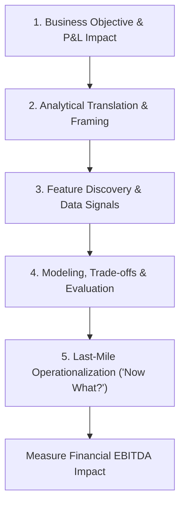

# Enterprise Analytics Framing: The Tredence "Last-Mile" Methodology

**Target Role:** Data Scientist / Associate Data Scientist | Tredence Analytics  
**Context:** IIT Kanpur Placement Season 2026–27  
**Core Consulting Doctrine:** Bridging the gap between mathematical model outputs and executive operational action.

---

## 1. The "Last-Mile" Adoption Problem

In enterprise analytics, over 80% of data science models fail to deliver bottom-line EBITDA value. They succeed mathematically (achieving $\text{AUC} > 0.90$ or low RMSE) but fail operationally because:
1. **The Disconnect:** Data scientists present statistical metrics (F1-score, log-loss) that C-suite executives cannot translate into revenue or cost savings.
2. **The Inertia:** Frontline operations (store managers, supply chain dispatchers, sales reps) continue using legacy Excel heuristics because the ML model is an uninterpretable "black box".
3. **The Missing "Now What?":** The model flags a problem (e.g., "Store #104 has a 78% risk of stockout") but fails to provide a prescriptive operational workflow to resolve it.

**The Tredence Philosophy:** A model is complete only when the analytical output is embedded into a frontline decision workflow with measurable financial ROI.

---

## 2. The 5-Step Enterprise Problem-Solving Framework

### Step 1: Business Objective & P&L Impact
- What executive metric is at stake? (Revenue, Gross Margin, Customer Lifetime Value, Working Capital, Waste/Spoilage).
- What is the cost of inaction?
- What are the physical operational constraints? (Warehouse capacity, marketing budget, delivery lead times).

### Step 2: Analytical Translation & Framing
- Convert ambiguous business requests into rigorous mathematical formulations:
  - *"We want customers to buy more"* $\to$ Bipartite recommendation engine + Uplift modeling ($CATE$).
  - *"We are throwing away expired fresh produce"* $\to$ Probabilistic quantile demand forecasting ($\tau = 0.90$) + Integer Linear Programming (ILP) replenishment optimization.
  - *"Subscribers are leaving after discount expires"* $\to$ Survival analysis / Time-to-event Hazard modeling + LightGBM churn classification.

### Step 3: Feature Discovery & Data Signals
- Audit available internal and external data assets:
  - Internal: Point-of-Sale (POS) transactions, ERP inventory logs, CRM clickstreams, customer service tickets.
  - External: Macro-economic indices, weather telemetry, competitor local pricing, regional demographic trends.
- Enforce strict temporal ordering to prevent lookahead target leakage.

### Step 4: Modeling, Trade-offs & Evaluation
- Model selection based on the **Accuracy vs Explainability vs Latency** trade-off.
- Offline metrics: WAPE (demand), PR-AUC (churn/fraud), NDCG@K (recommendations).
- Online evaluation: Randomized Controlled Trials (A/B testing, Switchback experiments) measuring Net Incremental EBITDA.

### Step 5: Last-Mile Operationalization ("Now What?")
- Embed predictions into frontline tools:
  - Push daily prioritized action lists to store managers' tablets.
  - Embed dynamic pricing recommendations directly into POS checkout registers.
  - Provide local TreeSHAP explanations justifying the recommended action to build frontline trust.

---

## 3. Financial Payoff Formulation: The Business Case Matrix

In case interviews, never stop at model accuracy. Always formulate the **Net Financial ROI Equation**:

$$\text{Net EBITDA Lift} = (\text{True Positives} \times \text{Gross Value per Intervention} \times \text{Frontline Success Rate}) - (\text{Total Interventions} \times \text{Unit Cost of Action}) - \text{Infrastructure Cost}$$

### Concrete Case Example: Customer Churn Retention
- Total high-risk customer pool flagged: $N = 10,000$.
- Precision of model: $40\% \implies \text{True Positives} = 4,000$ real churners; $\text{False Positives} = 6,000$.
- Customer Lifetime Value (CLV): $\$1,200$.
- Frontline retention offer acceptance rate: $25\%$.
- Cost of retention offer: $\$50$ per customer contacted.
- **Financial Payoff:**
  - Value Saved $= 4,000 \times \$1,200 \times 0.25 = \$1,200,000$.
  - Campaign Contact Cost $= 10,000 \times \$50 = \$500,000$.
  - **Net Incremental Profit $= \$1,200,000 - \$500,000 = \$700,000$ (ROI: $+140\%$).**
